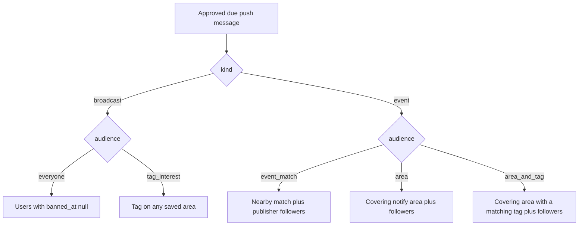

# How notification recipients are selected

The worker picks recipients when it sends an approved `push_messages` row, not when the
event is published. It re-reads areas, area tags, and follows at that moment, writes one
inbox row per selected user, then sends a silent Expo push to that user’s devices that
have a token.

Publishing only creates the draft. `event.published` updates publisher stats. A message
is sent only when it is `approved`, its `send_at` is due (or empty), and — for an event
message — the event is `published`. `pending`, `rejected`, and `cancelled` messages are
not sent. A user who changes areas, area tags, or follows after the draft was created is
included or left out based on the data at send time.

Quiet hours and the 5-per-day cap do not change this set. They only decide whether the
phone shows a banner after the push arrives.

There is no account-wide interest list. Tags that decide a nearby notification live on
the saved area (`user_area_tags`).

## Which audience the message uses

| `push_messages.audience` | Who is selected | Inbox `reason` |
| --- | --- | --- |
| `event_match` | Nearby match **or** a follow of the event’s publisher. Nearby wins when both match. | `nearby` or `publisher` |
| `area` | Saved notify area covers the event, **or** a follow of the publisher. No tag check for the area path. | `nearby` or `publisher` |
| `area_and_tag` | Covering area has a matching tag, **or** a follow of the publisher. | `nearby` or `publisher` |
| `everyone` | Every user who is not banned. | `broadcast` |
| `tag_interest` | Users who are not banned and have `audience_tag_id` on any saved area. | `broadcast` |

Publisher drafts (“notify on publish”, “Notify again”) use `event_match`. Admin reminders
and a publisher’s import plan use `area` or `area_and_tag`. Import plans always use
`area_and_tag`. Broadcasts use `everyone` or `tag_interest` and have no event.

A follow of the publisher is included on every event notification (`event_match`, `area`,
and `area_and_tag`), including when the event has no point. Broadcasts are not tied to a
publisher, so a follow does not add anyone there.

## Nearby match

Used by `event_match` and `area_and_tag`. A user is included when all of these are true:

1. The event is `published` and has a point (`events.location` is set).
2. The user has a saved area with `active = true` and `notify = true` that covers the
   event point:
   - a circle matches with `ST_DWithin(center, event point, radius_m)`
   - a polygon or copied region boundary matches with `ST_Covers(area, event point)`
3. That same area has at least one tag in `user_area_tags` that the event also has.
   Tags on a different area do not count. An area with no tags does not match. The app stores
   that area’s notifications off when the list is empty, including after skip or clearing the
   last category, so the switch matches this rule.

One covering area with one shared tag is enough. The phone’s current “Near you”
location is not an area and is not used.

An event with no point, or with no tags, has no nearby recipients. Followers of the
publisher are still selected.

## Area only

`area` uses the same covering-area rule and skips the tag check. The event still has to
be `published` and have a point for this path. Followers are added even when the event
has no point.

## Publisher followers

Every event notification includes followers. A follow is a `subscriptions` row with
`target_type = 'publisher'` and `target_id` equal to the event’s publisher. Place and
tags are not checked.

If the same user is also a nearby or area match, the inbox reason is `nearby`.

Saving an event and marking “I’m coming” do not select a recipient. Following a single
event (`subscriptions.target_type = 'event'`) does not either.

## Broadcasts

`everyone` selects users with `banned_at` null. `tag_interest` selects the same users
who have that tag on any saved area (`user_area_tags`). There is no area-coverage check.

Event audiences (`event_match`, `area`, `area_and_tag`) do not filter on `banned_at`.

## Caps, inbox, and push

Each event path (nearby, area, followers) returns at most **500** distinct users. The
queries have no ordering, so a path that hits the cap drops an arbitrary remainder.
Broadcasts return at most **5,000** users.

Selection is per user. A push token is not required to be selected: the inbox row is
stored either way. The silent push then goes to that user’s devices that are not revoked
and have an Expo token.

The same user is not given a second inbox row for the same message and reason
(`notifications` is unique on user, push message, and reason). A delivery already marked
`sent` or `dry_run` is skipped. If another approved message for that same user is due
within 10 minutes, this message waits and is delivered with it: still one inbox row per
message, one push for the bundle.

Related flow: [flows/push-and-domain-events.md](./flows/push-and-domain-events.md).
Import reminders: [flows/publisher-import-notifications.md](./flows/publisher-import-notifications.md).
