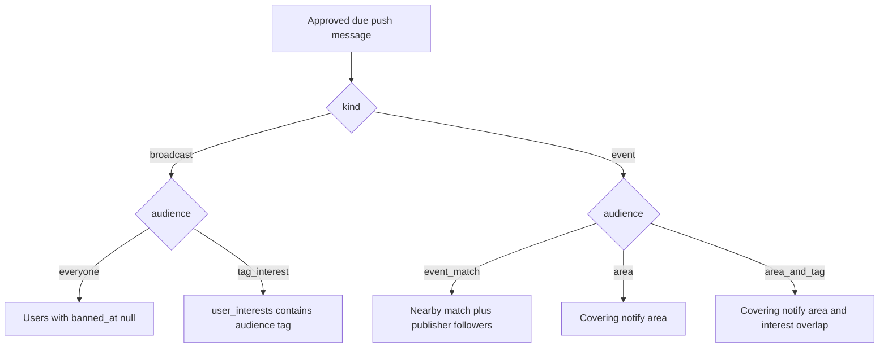

# How notification recipients are selected

The worker picks recipients when it sends an approved `push_messages` row, not when the
event is published. It re-reads areas, interests, and follows at that moment, writes one
inbox row per selected user, then sends a silent Expo push to that user’s devices that
have a token.

Publishing only creates the draft. `event.published` updates publisher stats. A message
is sent only when it is `approved`, its `send_at` is due (or empty), and — for an event
message — the event is `published`. `pending`, `rejected`, and `cancelled` messages are
not sent. A user who changes areas or interests after the draft was created is included
or left out based on the data at send time.

Quiet hours and the 5-per-day cap do not change this set. They only decide whether the
phone shows a banner after the push arrives.

## Which audience the message uses

| `push_messages.audience` | Who is selected | Inbox `reason` |
| --- | --- | --- |
| `event_match` | Nearby match **or** a follow of the event’s publisher. Nearby wins when both match. | `nearby` or `publisher` |
| `area` | Saved notify area covers the event. No tag check. Followers are not added. | `nearby` |
| `area_and_tag` | Saved notify area covers the event **and** a notification interest overlaps an event tag. Followers are not added. | `nearby` |
| `everyone` | Every user who is not banned. | `broadcast` |
| `tag_interest` | Users who are not banned and have `audience_tag_id` in their notification interests. | `broadcast` |

Publisher drafts (“notify on publish”, “Notify again”) use `event_match`. Admin reminders
and a publisher’s import plan use `area` or `area_and_tag`. Import plans always use
`area_and_tag`. Broadcasts use `everyone` or `tag_interest` and have no event.

## Nearby match

Used by `event_match` and `area_and_tag`. A user is included when all of these are true:

1. The event is `published` and has a point (`events.location` is set).
2. The event has at least one tag, and the user has that same tag in `user_interests`.
   Empty interests match nobody. Tags stored on a saved area (`user_area_tags`) are not
   read here.
3. The user has a saved area with `active = true` and `notify = true` that covers the
   event point:
   - a polygon or copied region boundary matches with `ST_Covers(area, event point)`
   - a circle matches with `ST_DWithin(center, event point, radius_m)`

One covering area is enough. The tags on that area do not have to be the overlapping
interest. An area with `notify = false` or `active = false` is ignored. The phone’s
current “Near you” location is not an area and is not used.

An event with no point, or with no tags, has no nearby recipients.

## Area only

`area` uses the same covering-area rule and skips the interest check. The event still
has to be `published` and have a point. Followers are not added. An event with no point
has no recipients for this audience.

## Publisher followers

Only `event_match` adds followers. A follow is a `subscriptions` row with
`target_type = 'publisher'` and `target_id` equal to the event’s publisher. Place and
tags are not checked, so an event with no point still reaches followers.

If the same user is also a nearby match, the inbox reason is `nearby`.

Saving an event, marking “I’m coming”, and following a single event
(`subscriptions.target_type = 'event'`) do not select a recipient. Updates do not notify
event followers yet.

## Broadcasts

`everyone` selects users with `banned_at` null. `tag_interest` selects the same users
who have that tag in `user_interests`. There is no area check.

Event audiences (`event_match`, `area`, `area_and_tag`) do not filter on `banned_at`.

## Caps, inbox, and push

Each event path (nearby, area, followers) returns at most **500** distinct users. The
queries have no ordering, so a path that hits the cap drops an arbitrary remainder.
Broadcasts return at most **5,000** users.

Selection is per user. A push token is not required to be selected: the inbox row is
stored either way. The silent push then goes to that user’s devices that are not revoked
and have an Expo token.

The same user is not given a second inbox row for the same message and reason
(`notifications` is unique on user, push message, and reason). A delivery already marked
`sent` or `dry_run` is skipped. If another approved message for that same user is due
within 10 minutes, this message waits and is delivered with it: still one inbox row per
message, one push for the bundle.

Related flow: [flows/push-and-domain-events.md](./flows/push-and-domain-events.md).
Import reminders: [flows/publisher-import-notifications.md](./flows/publisher-import-notifications.md).
