# Build Plan

Estimate for 2–3 full-stack developers; weeks from kickoff. Re-plan after Phase 1. Each phase ends
with something usable end to end on every client that needs it. Architecture and rules are in
[project-description.md](project-description.md).

```mermaid
gantt
  dateFormat  X
  axisFormat  wk %s
  section Core
  1. Foundations                 :p1, 0, 2
  2. Publishers + events         :p2, 2, 6
  3. Discovery + notifications   :p3, 6, 10
  4. Check-in + content          :p4, 10, 13
  5. Ratings + stats             :p5, 13, 15
  Closed beta                    :milestone, 15, 0
  6. Beta + hardening            :p6, 15, 19
  Store launch                   :milestone, 19, 0
  section Parallel
  Admin console                  :a1, 4, 12
  Data workers                   :d1, 6, 12
```

Closed beta around week 15, store launch around week 19.

## Phase 1 — Foundations (weeks 0–2)

- [x] Monorepo scaffold (pnpm + Turborepo), shared tsconfig, Prettier, CI workflow
- [x] Starter packages: `contracts`, `geo`, `domain`, `auth`, `ingest`, `db`
- [x] API, admin API, worker and data-workers skeletons with tests and Dockerfiles
- [x] Docker Compose for Postgres + PostGIS, Valkey, and ElasticMQ (local SQS); first migrations
- [x] CDK app with network stack
- [x] Create `apps/mobile`, `apps/web`, `apps/admin` (see `apps/README.md`)
- [x] i18n setup on all three frontends: Swedish default, English
- [x] shadcn/ui on admin and web; mobile custom UI + `@expo/ui` / SwiftUI overlays
- [x] `POST /v1/identities` (anonymous device identity) + session exchange
- [x] Publisher registration + email verification + login (web)
- [x] OpenAPI → `packages/api-client` generation; Sentry on all apps
- [x] CDK data stack (RDS, Valkey, S3, SQS) and services stack for dev; deploy from CI
- **Exit:** a fresh install gets an identity, a publisher logs in on web, both deployed to dev from CI.

## Phase 2 — Publishers + events (weeks 2–6)

- [x] Publisher profiles; owner/editor members with email invites
- [x] Event CRUD (physical + digital), tags from the Visit Söderhamn vocabulary; image upload to S3 deferred
- [x] Event `language` (`sv` / `en`, default `sv`) and optional `summary`. `event_translations` holds other languages as JSON field maps (`event_id`, `language`, `data`)
- [x] Publishers that are not `published`: events stored as `awaiting_verification`, released when an admin publishes the publisher
- [x] Public event pages on web; list and map views in the app
- [x] Web sign-in by pairing code (app generates code → web exchanges for httpOnly cookie)
- [x] Device linking with the same pairing-code mechanism
- **Exit:** a publisher creates an event on web and it shows on the mobile map; an app user signs
  in on web with a code.

## Phase 3 — Discovery + notifications (weeks 6–10)

- [x] Saved areas (radius and polygon). The onboarding tags step stores the chosen tags on the area just saved and as the device home filters. There is no account-wide interest list. Nearby notifications use the tags on the covering area. An area with no categories has notifications stored off, including after skip or clearing the last category. The location menu search radius is remembered per place, including “Near you”, on the device and on the user. A new circle starts with that search radius equal to its notification radius
- [x] Region suggestions + region subscriptions (municipality boundaries seeded into `regions`). Device location is read when the app becomes active and watched while it stays in the foreground. A dismiss, including skipping the onboarding area step, hides the prompt near that place for 7 days; farther than the profile “How far can you go” setting (default 25 km) it can show again immediately. Continuing the onboarding area step stores the chosen radius as that travel distance
- [x] Push token registration; SQS + worker wired up
- [x] Geo matching; silent Expo after inbox insert; client-side quiet hours + 5/day OS-notification cap; 90-day inbox retention. Events without a point stay off the map, out of the public list, and do not match nearby push. Direct lookup by id still returns them. The public list also leaves out an event that has ended; a whole day stays through that calendar day
- [x] Publisher and event subscriptions (follow API + publisher merge on publish; event.updated debounce later)
- [x] Notification inbox: persist every matched notification; `GET /me/notifications`; mobile notifications window lists inbox rows
- [x] Event tips: home “Saknar du ett evenemang?” and profile “Mina tips”. Photo or text, Anthropic extraction, then the regular import scan on source `user-tips`. A visible push opens the thank-you screen when the tip is published, and the tip status otherwise. A lock-screen tap does the same. The inbox row opens the thank-you screen when the tip is published, and the tip status in a bottom sheet otherwise. The event stays `in_review` until an admin publishes it. `meta.fromUserTip` shows “Från användartips” and names no submitter. The event description is the written description. The chat lines are stored on `meta.tip`, which public responses omit. The scan prompt receives those lines along with the written description
- [x] Quiet hours deferral: during the window store only (no immediate Expo); after the window ends, one aggregate Expo push; preferences UI to enable/disable (defaults 22:00–08:00)
- [x] Push message drafts: create on submit, update on edit before send, new draft after send; admin approve / trusted auto-approve; optional `send_at`; worker sends due approved messages; inbox only at send
- [x] Per-user push aggregation within 10 minutes (defer + “And N more…”)
- [x] Admin push editor with audience estimate (nearby / followers / unique / with token)
- [x] Publisher “Notify again” after a send; admin broadcast composer (everyone / favorite tag) with schedule
- [x] Admin event notification: schedule an approved push for a published event, choosing saved-area or saved-area-plus-tag. Publisher followers receive every event notification. Several reminders can be scheduled; a marketing plan is created only after the admin approves the preview
- **Exit:** publishing drafts a push message; after approval (or auto-approve) and `send_at`, the worker inserts inbox rows and a silent push; aggregation prevents back-to-back OS alerts; admin can preview audience and schedule general broadcasts.

## Phase 4 — Check-in + attendee content (weeks 10–13)

- [x] Geofence check-in (`validateGeoCheckIn`) — venue QR fallback still open
- [x] Check-in is optional per event (admin toggle). When on, the publisher adds text and links
      that unlock after check-in
- [x] Venue QR fallback (uses digital codes)
- [x] Rotating digital codes with QR
- [x] Profile prompt at first check-in (named or anonymous) + optional recovery email
- [x] Attendee-only content via signed URLs; offline cache
- **Exit:** a test event runs end to end, physical and digital.

## Phase 5 — Ratings + stats (weeks 13–15)

- [x] Rating window and "How was it?" prompt; comments for named profiles only, visible to publisher/admin
- [x] Stats counters, nightly reconciliation, stats on user, event and publisher pages
- **Exit:** stats match a recompute from source tables.

## Discovery extras — saves, lists, price, links

- [x] Optional price on events (minor units, currency) and on ingestion
- [x] Typed event links (`tickets`, `registration`, `info`, `facebook`, `instagram`), one or many per event
- [x] Saved events in the database: `GET/PUT/DELETE /me/saved-events`
- [x] Custom lists: `GET/POST/PATCH/DELETE /me/lists` and list membership
- [x] Public event list filters: text, tag, price, sort. Home, calendar, and search category buttons are tags on a current published event inside the selected place
- [x] Show events buttons count the current tags and filters (`GET /events/count`). Caching that count is planned in `docs/flows/event-counts.md`
- [x] "I'm coming" (`GET/PUT/DELETE /me/coming-events`) and `sort=popular` from `numSaved` + `numComing`
- [x] Public events include the organizer name
- [x] Share event via OS sheet (web URL); Universal / App Links association routes on web
- [x] Event detail gallery: `imageUrls` on event payloads; the mobile hero swipes when there is more than one photo
- **Exit:** the app can save an event, keep a list, show a price, and open a ticket or registration link.

## Phase 6 — Beta + hardening (weeks 15–19)

- [x] Single-instance test server in `deploy/test`: web, admin, both APIs, the worker, Postgres,
      Valkey, ElasticMQ, and Garage on one EC2. CDK stays the path for the real accounts.
- [ ] TestFlight and Play internal testing
- [ ] Load test the matcher and ingestion
- [ ] Ad slots with consent dialog (UMP) and iOS tracking prompt
- [ ] Staging → prod; privacy labels / Data Safety forms; store submission
- **Exit:** apps approved in both stores; prod alarms green for a week.

## Parallel track — Admin console (from week 4)

- [x] Admin login (password + TOTP) + publisher verification queue
- [x] Admin email one-time-code login (alongside password + TOTP)
- [x] Entity CRUD (events, users, remaining publisher fields)
- [x] Publisher editor: name, slug, type, and import notification plan (nothing, or a marketing plan
      scheduled for published publishers' script imports). In-review imports get `pending`
      reminders; publishing the event approves them. The page lists the publisher's events.
      Delete is available when that list is empty.

- [x] Moderation queue for ratings and suspicious check-ins; user bans
- [x] Data-source management with run history and a manual run button
- [x] Review queue for imported events; publisher mapping queue (re-map a temporary publisher to an
      existing one, moving its events, or fill in its details)
- [x] Import review: select rows and publish, reject, scan again, delete, or wipe. Delete cancels an
      imported `in_review` event and keeps the row. Wipe removes it and records
      `import_suppressions` so the same external id is not imported again. Scan again also
      accepts a published import and returns it to `pending_scan`.
- [x] Event catalog: one Ta bort action for any event. Confirmation marks the row `deleted` and
      removes it from lists, unless Ta bort permanent is checked, which removes the row. A later
      import skips a `deleted` source id.
- [x] Audit log viewer
- [x] Collapse occasions on the admin event page. Checked events move their
      `event_occasions` and child rows to the open event, then the checked event rows are deleted.

## Parallel track — Data workers (from week 6)

- [x] `ingest` package: `IncomingEvent`, adapter interface, content hash, dedupe pre-check
- [x] Runner with an example fixture adapter
- [x] Persist: upsert, `external_refs`, `ingestion_runs`. A new import is `pending_scan` with no
      publisher. The scan job resolves the publisher, duplicate check, and tags, then sets
      `in_review` or `published`. A physical import with no venue name stores the city from its address on `meta.import.venueName`, or the nearest city within 25 km of its point when that address has no city.
- [x] Import scan queue: `pending_scan` rows, batch prompt runner, Ollama model client, EventBridge
      schedule every 5 minutes (`JOB=event-scan`). `CHAT_PROVIDER=runpod` serves that job from one
      GPU pod of one, two, or four A40s, 25 scans at a time, and stops the pod when the run ends. More than one GPU disables vLLM custom all-reduce and NCCL peer access, and a pod started without that is replaced. A later scan starts that same pod. A start with no free GPU retries until one is free, and the pod stays. A duplicate ranked over 90 as another showing
      stores `meta.possibleOccasionGroupId` on the scanned event and those duplicates. A new temporary publisher is `pending_scan`. A separate publisher scan (`JOB=publisher-scan`) looks it up on the web (`BRAVE_API_KEY`), stores the profile on `publishers.meta.lookup`, stores a fetched website as an organizer key, and sets `in_review`. Steps from the description are stored on `events.meta.instructions`. Tip chat lines, and a step that only asks someone to confirm a field, are left out. Possible venue names come back from the model. Importers leave `event_occasions.venue_name` empty and store the name on `meta.import.venueName`. Visit Söderhamn also stores the arena name on `meta.import.arenaName`. The scan prompt passes the arena name, then that venue name, as the location. The highest rank above 80 is written. When the model returns none, the arena name is written, then the imported venue name. A later import does not clear a venue the scan already wrote. A later import that sends no tags leaves the scan's tags in place.
- [x] Raw ingestion payloads to S3 (`raw/<slug>/<runId>`; no-op when `RAW_INGESTION_BUCKET` unset)
- [x] Fargate task definition + EventBridge Scheduler schedules in CDK
- [x] First real source: Visit Söderhamn adapter (Citybreak, Evenemang only). Occasions follow the shared collapse rule with Glada Hudik and Destination Hälsingland.
- [x] Event images: copy into public assets (Garage locally, S3 + CloudFront in AWS) and link via
      `event_images`. Visit Söderhamn fills a missing hero from a linked page (`og:image`, then
      ``) and stores the other crawled images as gallery roles
- [x] Remaining launch-area sources (generic `ics-feed` adapter + seed; configure `feedUrl` per
      calendar — Visit Gävle has no public ICS yet)
- [x] Glada Hudik public calendar (`glada-hudik`, no API key). The import saves each event before the next page is fetched and does not attach tags. A page without a map point is saved without a point. The scan geocodes a missing point later.
- [x] Destination Hälsingland public calendar JSON (`destination-halsingland`, no API key). The worker reads the event list (`filter=c=4559`), then each product’s text and occasions, and saves that product before the next one is fetched. A missing coordinate stays missing. Gatuadress, Postadress, and the list coordinate are stored on `meta.address`. Later sources:
      `docs/event-sources.md`
- [x] Söderhamns stadsbibliotek (`soderhamn-biblioteket`). Sitevision event pages. The worker reads the calendar list, then each event page, and saves that event before the next page is fetched. `robots.txt` disallows `jsessionid` URLs, so later pages use `skip` without a session id. A date that cannot be read is still saved, with empty start and end.
- [x] Bollnäs kommun (`bollnas-kommun`). Soleil eventsCalendar JSON the calendar page already loads. The worker reads `/items?start=` and saves each row before the next page. `robots.txt` disallows `jsessionid` URLs. A `Z` time is that instant. The place is stored on `meta.address`. The import does not geocode. Tickster stays next once an API key exists.
- **Exit:** sources run on schedule unattended, and an imported event notifies users exactly like a
  native one.

## Future — paid plans (not scheduled)

Stripe Billing on the web workspace, plan picker and upgrade flow, paid featured placements on the
start page, enforcement of plan limits, admin tools for plans and refunds. Admins can already mark
an event featured so it sorts first on the home page. For you leaves those
events out. Admins can also mark an event sponsored and upload a poster; that poster
shows in the upcoming lists on the home page and the events screen. Entitlement checks already exist
(`packages/domain/src/entitlements.ts`), so the rest is mostly billing and UI.
