# Build Plan

Estimate for 2–3 full-stack developers; weeks from kickoff. Re-plan after Phase 1. Each phase ends
with something usable end to end on every client that needs it. Architecture and rules are in
[project-description.md](project-description.md).

```mermaid
gantt
  dateFormat  X
  axisFormat  wk %s
  section Core
  1. Foundations                 :p1, 0, 2
  2. Publishers + events         :p2, 2, 6
  3. Discovery + notifications   :p3, 6, 10
  4. Check-in + content          :p4, 10, 13
  5. Ratings + stats             :p5, 13, 15
  Closed beta                    :milestone, 15, 0
  6. Beta + hardening            :p6, 15, 19
  Store launch                   :milestone, 19, 0
  section Parallel
  Admin console                  :a1, 4, 12
  Data workers                   :d1, 6, 12
```

Closed beta around week 15, store launch around week 19.

## Phase 1 — Foundations (weeks 0–2)

- [x] Monorepo scaffold (pnpm + Turborepo), shared tsconfig, Prettier, CI workflow
- [x] Starter packages: `contracts`, `geo`, `domain`, `auth`, `ingest`, `db`
- [x] API, admin API, worker and data-workers skeletons with tests and Dockerfiles
- [x] Docker Compose for Postgres + PostGIS, Valkey, and ElasticMQ (local SQS); first migrations
- [x] CDK app with network stack
- [x] Create `apps/mobile`, `apps/web`, `apps/admin` (see `apps/README.md`)
- [x] i18n setup on all three frontends: Swedish default, English
- [x] Material UI on admin and web; mobile custom UI + `@expo/ui` / SwiftUI overlays
- [x] `POST /v1/identities` (anonymous device identity) + session exchange
- [x] Publisher registration + email verification + login (web)
- [x] OpenAPI → `packages/api-client` generation; Sentry on all apps
- [x] CDK data stack (RDS, Valkey, S3, SQS) and services stack for dev; deploy from CI
- **Exit:** a fresh install gets an identity, a publisher logs in on web, both deployed to dev from CI.

## Phase 2 — Publishers + events (weeks 2–6)

- [x] Publisher profiles; owner/editor members with email invites
- [x] Event CRUD (physical + digital), tags from the Visit Söderhamn vocabulary; image upload to S3 deferred
- [x] Unverified publishers: events stored as `awaiting_verification`, released on verification
- [x] Public event pages on web; list and map views in the app
- [x] Web sign-in by pairing code (app generates code → web exchanges for httpOnly cookie)
- [x] Device linking with the same pairing-code mechanism
- **Exit:** a publisher creates an event on web and it shows on the mobile map; an app user signs
  in on web with a code.

## Phase 3 — Discovery + notifications (weeks 6–10)

- [x] Interests, saved areas (radius and polygon)
- [x] Region suggestions + region subscriptions (municipality boundaries seeded into `regions`). Device location is read when the app becomes active and watched while it stays in the foreground. A dismiss, including skipping the onboarding area step, hides the prompt near that place for 7 days; farther than the profile “How far can you go” setting (default 25 km) it can show again immediately. Continuing the onboarding area step stores the chosen radius as that travel distance
- [x] Push token registration; SQS + worker wired up
- [x] Geo matching; silent Expo after inbox insert; client-side quiet hours + 5/day OS-notification cap; 90-day inbox retention. Events without a point stay in the list and off the map, and they do not match nearby push
- [x] Publisher and event subscriptions (follow API + publisher merge on publish; event.updated debounce later)
- [x] Notification inbox: persist every matched notification; `GET /me/notifications`; mobile notifications window lists inbox rows
- [x] Quiet hours deferral: during the window store only (no immediate Expo); after the window ends, one aggregate Expo push; preferences UI to enable/disable (defaults 22:00–08:00)
- [x] Push message drafts: create on submit, update on edit before send, new draft after send; admin approve / trusted auto-approve; optional `send_at`; worker sends due approved messages; inbox only at send
- [x] Per-user push aggregation within 10 minutes (defer + “And N more…”)
- [x] Admin push editor with audience estimate (nearby / followers / unique / with token)
- [x] Publisher “Notify again” after a send; admin broadcast composer (everyone / favorite tag) with schedule
- [x] Admin event notification: schedule an approved push for a published event, choosing saved-area or saved-area-plus-interest (no followers). Several reminders can be scheduled; a marketing plan is created only after the admin approves the preview
- **Exit:** publishing drafts a push message; after approval (or auto-approve) and `send_at`, the worker inserts inbox rows and a silent push; aggregation prevents back-to-back OS alerts; admin can preview audience and schedule general broadcasts.

## Phase 4 — Check-in + attendee content (weeks 10–13)

- [x] Geofence check-in (`validateGeoCheckIn`) — venue QR fallback still open
- [x] Check-in is optional per event (admin toggle). When on, the publisher adds text and links
      that unlock after check-in
- [x] Venue QR fallback (uses digital codes)
- [x] Rotating digital codes with QR
- [x] Profile prompt at first check-in (named or anonymous) + optional recovery email
- [x] Attendee-only content via signed URLs; offline cache
- **Exit:** a test event runs end to end, physical and digital.

## Phase 5 — Ratings + stats (weeks 13–15)

- [x] Rating window and "How was it?" prompt; comments for named profiles only, visible to publisher/admin
- [x] Stats counters, nightly reconciliation, stats on user, event and publisher pages
- **Exit:** stats match a recompute from source tables.

## Discovery extras — saves, lists, price, links

- [x] Optional price on events (minor units, currency) and on ingestion
- [x] Typed event links (`tickets`, `registration`, `info`), one or many per event
- [x] Saved events in the database: `GET/PUT/DELETE /me/saved-events`
- [x] Custom lists: `GET/POST/PATCH/DELETE /me/lists` and list membership
- [x] Public event list filters: text, tag, price, sort
- [x] "I'm coming" (`GET/PUT/DELETE /me/coming-events`) and `sort=popular` from `numSaved` + `numComing`
- [x] Public events include the organizer name
- [x] Share event via OS sheet (web URL); Universal / App Links association routes on web
- [x] Event detail gallery: `imageUrls` on event payloads; the mobile hero swipes when there is more than one photo
- **Exit:** the app can save an event, keep a list, show a price, and open a ticket or registration link.

## Phase 6 — Beta + hardening (weeks 15–19)

- [ ] TestFlight and Play internal testing
- [ ] Load test the matcher and ingestion
- [ ] Ad slots with consent dialog (UMP) and iOS tracking prompt
- [ ] Staging → prod; privacy labels / Data Safety forms; store submission
- **Exit:** apps approved in both stores; prod alarms green for a week.

## Parallel track — Admin console (from week 4)

- [x] Admin login (password + TOTP) + publisher verification queue
- [x] Entity CRUD (events, users, remaining publisher fields)
- [x] Moderation queue for ratings and suspicious check-ins; user bans
- [x] Data-source management with run history and a manual run button
- [x] Review queue for imported events; publisher mapping queue (re-map a temporary publisher to an
      existing one, moving its events, or fill in its details)
- [x] Audit log viewer

## Parallel track — Data workers (from week 6)

- [x] `ingest` package: `IncomingEvent`, adapter interface, content hash, dedupe pre-check
- [x] Runner with an example fixture adapter
- [x] Persist: publisher resolution via `publisher_aliases`, dedupe, upsert, `external_refs`,
      `ingestion_runs`. Published imports enqueue domain events; review imports stay `in_review`
- [x] Raw ingestion payloads to S3 (`raw/<slug>/<runId>`; no-op when `RAW_INGESTION_BUCKET` unset)
- [x] Fargate task definition + EventBridge Scheduler schedules in CDK
- [x] First real source: Visit Söderhamn adapter (Citybreak, Evenemang only, one event per occasion)
- [x] Event images: copy into public assets (Garage locally, S3 + CloudFront in AWS) and link via
      `event_images`. Visit Söderhamn fills a missing hero from a linked page (`og:image`, then
      ``) and stores the other crawled images as gallery roles
- [x] Remaining launch-area sources (generic `ics-feed` adapter + seed; configure `feedUrl` per
      calendar — Visit Gävle has no public ICS yet)
- **Exit:** sources run on schedule unattended, and an imported event notifies users exactly like a
  native one.

## Future — paid plans (not scheduled)

Stripe Billing on the web workspace, plan picker and upgrade flow, paid featured placements on the
start page, enforcement of plan limits, admin tools for plans and refunds. Admins can already mark
an event featured so it sorts first on the home page. For you leaves those
events out. Entitlement checks already exist
(`packages/domain/src/entitlements.ts`), so the rest is mostly billing and UI.
