# Build Plan

Estimate for 2–3 full-stack developers; weeks from kickoff. Re-plan after Phase 1. Each phase ends
with something usable end to end on every client that needs it. Architecture and rules are in
[project-description.md](project-description.md).

```mermaid
gantt
  dateFormat  X
  axisFormat  wk %s
  section Core
  1. Foundations                 :p1, 0, 2
  2. Publishers + events         :p2, 2, 6
  3. Discovery + notifications   :p3, 6, 10
  4. Check-in + content          :p4, 10, 13
  5. Ratings + stats             :p5, 13, 15
  Closed beta                    :milestone, 15, 0
  6. Beta + hardening            :p6, 15, 19
  Store launch                   :milestone, 19, 0
  section Parallel
  Admin console                  :a1, 4, 12
  Data workers                   :d1, 6, 12
```

Closed beta around week 15, store launch around week 19.

## Phase 1 — Foundations (weeks 0–2)

- [x] Monorepo scaffold (pnpm + Turborepo), shared tsconfig, Prettier, CI workflow
- [x] Starter packages: `contracts`, `geo`, `domain`, `auth`, `ingest`, `db`
- [x] API, admin API, worker and data-workers skeletons with tests and Dockerfiles
- [x] Docker Compose for Postgres + PostGIS and Valkey; first migrations
- [x] CDK app with network stack
- [x] Create `apps/mobile`, `apps/web`, `apps/admin` (see `apps/README.md`)
- [x] i18n setup on all three frontends: Swedish default, English
- [x] Material UI on admin and web; mobile custom UI + `@expo/ui` / SwiftUI overlays
- [x] `POST /v1/identities` (anonymous device identity) + session exchange
- [x] Publisher registration + email verification + login (web)
- [x] OpenAPI → `packages/api-client` generation; Sentry on all apps
- [x] CDK data stack (RDS, Valkey, S3, SQS) and services stack for dev; deploy from CI
- **Exit:** a fresh install gets an identity, a publisher logs in on web, both deployed to dev from CI.

## Phase 2 — Publishers + events (weeks 2–6)

- [x] Publisher profiles; owner/editor members with email invites
- [x] Event CRUD (physical + digital), categories (sv/en names); image upload to S3 deferred
- [x] Unverified publishers: events stored as `awaiting_verification`, released on verification
- [x] Public event pages on web; list and map views in the app
- [x] Web sign-in by pairing code (app generates code → web exchanges for httpOnly cookie)
- [x] Device linking with the same pairing-code mechanism
- **Exit:** a publisher creates an event on web and it shows on the mobile map; an app user signs
  in on web with a code.

## Phase 3 — Discovery + notifications (weeks 6–10)

- [x] Interests, saved areas (radius and polygon)
- [x] Region suggestions + region subscriptions (municipality boundaries seeded into `regions`)
- [ ] Push token registration; SQS + worker wired up
- [ ] Geo matching, publisher and event subscriptions, caps and quiet hours
- **Exit:** publishing an event pushes a notification to a matching phone within one minute.

## Phase 4 — Check-in + attendee content (weeks 10–13)

- [ ] Geofence check-in (`validateGeoCheckIn`), venue QR fallback
- [ ] Rotating digital codes with QR
- [ ] Profile prompt at first check-in (named or anonymous) + optional recovery email
- [ ] Attendee-only content via signed URLs; offline cache
- **Exit:** a test event runs end to end, physical and digital.

## Phase 5 — Ratings + stats (weeks 13–15)

- [ ] Rating window and "How was it?" prompt; comments for named profiles only, visible to publisher/admin
- [ ] Stats counters, nightly reconciliation, stats on user, event and publisher pages
- **Exit:** stats match a recompute from source tables.

## Phase 6 — Beta + hardening (weeks 15–19)

- [ ] TestFlight and Play internal testing
- [ ] Load test the matcher and ingestion
- [ ] Ad slots with consent dialog (UMP) and iOS tracking prompt
- [ ] Staging → prod; privacy labels / Data Safety forms; store submission
- **Exit:** apps approved in both stores; prod alarms green for a week.

## Parallel track — Admin console (from week 4)

- [ ] Entity CRUD, publisher verification queue
- [ ] Moderation queue for ratings and suspicious check-ins; user bans
- [ ] Data-source management with run history and a manual run button
- [ ] Review queue for imported events; publisher mapping queue (re-map a temporary publisher to an
      existing one, moving its events, or fill in its details)
- [ ] Audit log viewer

## Parallel track — Data workers (from week 6)

- [x] `ingest` package: `IncomingEvent`, adapter interface, content hash, dedupe pre-check
- [x] Runner with an example fixture adapter
- [ ] Persist: publisher resolution via `publisher_aliases`, dedupe, upsert, `external_refs`,
      `ingestion_runs`, domain events to SQS, raw payloads to S3
- [ ] Fargate task definition + EventBridge Scheduler schedules in CDK
- [ ] First 2–3 real sources (official API or ICS feed before any HTML scraping) — list pending
- **Exit:** sources run on schedule unattended, and an imported event notifies users exactly like a
  native one.

## Future — paid plans (not scheduled)

Stripe Billing on the web workspace, plan picker and upgrade flow, featured placements on the start
page, enforcement of plan limits, admin tools for plans and refunds. Entitlement checks already
exist (`packages/domain/src/entitlements.ts`), so this is mostly billing and UI.
