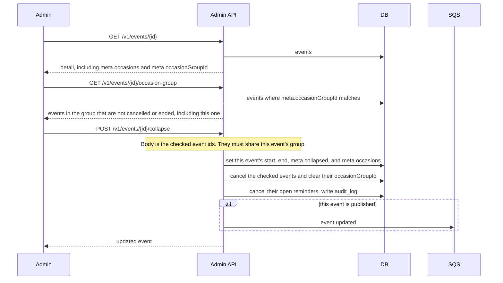

# Collapse occasions in admin

Staff open an event that already has several `meta.occasions` rows, or an `meta.occasionGroupId`.
The admin session cookie is required. The Tillfällen tab lists the stored occasions, then every
event in the group. The open event is shown in gray and cannot be checked.

The event start is the earliest occasion start. The end is the latest occasion end. A later import
of a cancelled source id leaves that row cancelled.
