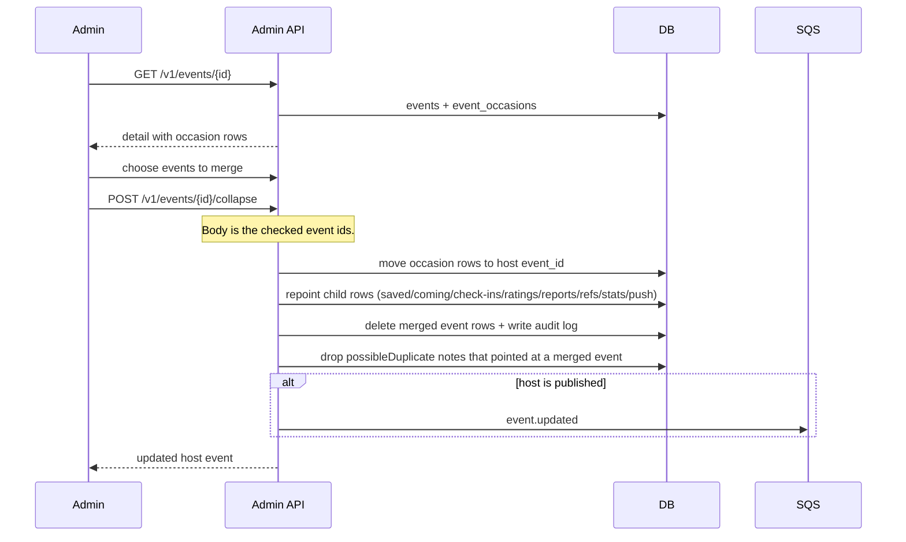

# Collapse occasions in admin

Staff open an event and pick one or more other events to fold into it. The admin session cookie is
required. The Tillfallen tab lists this event's rows from `event_occasions`.

Collapse moves selected events' occasion rows onto the open event. A moved showing with no venue takes the venue from the first target showing that has one, in start order. It repoints child rows (saves,
coming, check-ins, ratings, reports, tags, translations, images, links, refs, stats, and push),
and deletes the checked event rows. Their source ids move with `external_refs`, so a later import
updates the surviving event. Any surviving event drops `meta.possibleDuplicate` when that note
pointed at a folded event.

The surviving event keeps one id. Future imports of a merged source id update that event.
