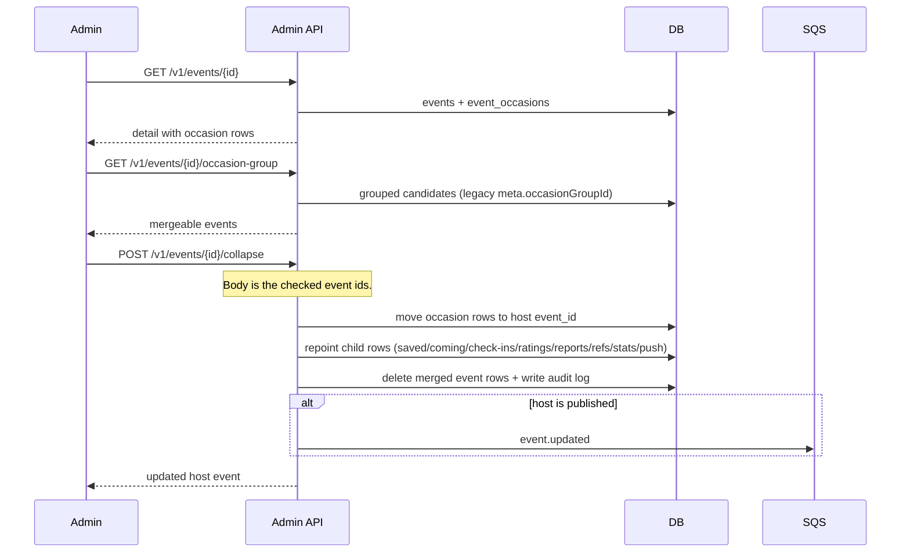

# Collapse occasions in admin

Staff open an event and pick one or more other events to fold into it. The admin session cookie is
required. The Tillfallen tab lists the event's occasion rows from `event_occasions`. Older grouped
imports can still use the group list to pick merge candidates.

The surviving event keeps one id. Future imports update that event through the rewritten
`external_refs` product id mapping.
