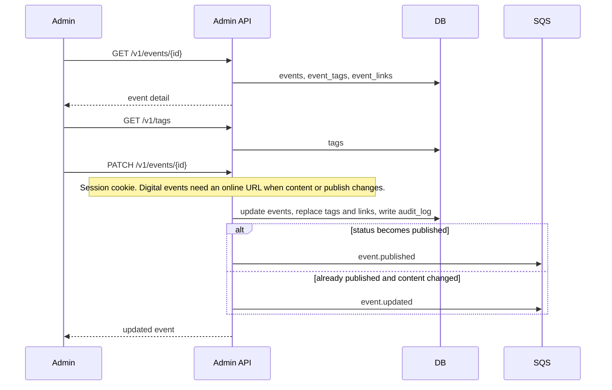

# Admin view and edit an event

Staff open an event from the catalog or the import review queue. The admin session cookie is required.

Cancelling with `{ "status": "cancelled" }` skips the place and online-URL checks so a broken import can still be taken down.

`featured` is the same kind of change: it does not require a place or online URL. A later import does not clear it. Published featured events sort first on the public list and the home page.

`checkInEnabled` is also that kind of change. When it is on, the publisher can add text and links that stay hidden until check-in. Turning it on does not require a place or online URL, and a later import does not clear it.
