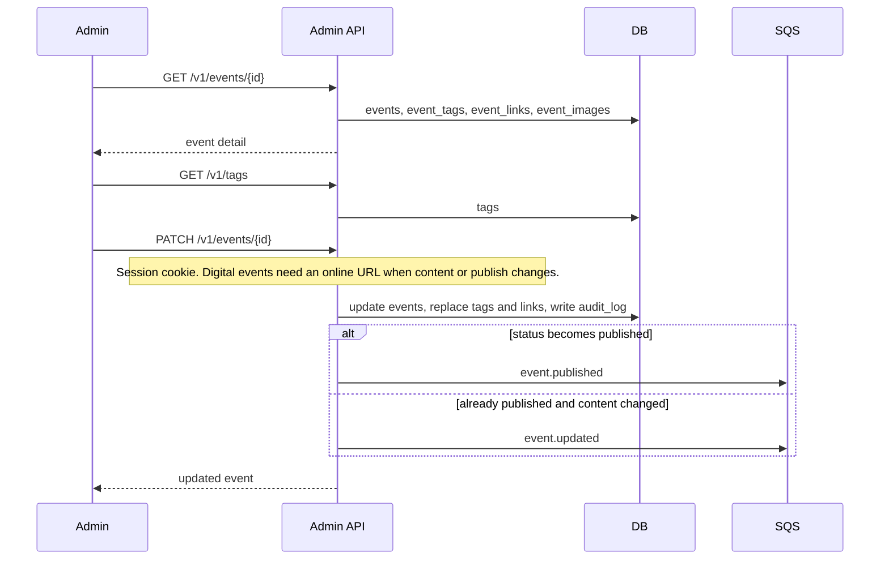
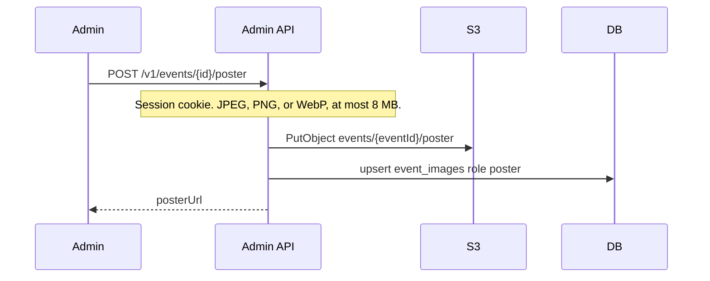

# Admin view and edit an event

Staff open an event from the catalog or the import review queue. The admin session cookie is required.

Cancelling with `{ "status": "cancelled" }` skips the place and online-URL checks so a broken import can still be taken down.

`featured` is the same kind of change: it does not require a place or online URL. A later import does not clear it. Published featured events sort first on the public list and the home page.

`sponsored` is the same kind of change. The poster is a separate upload, `POST /v1/events/{id}/poster`, with the raw image as the body (`image/jpeg`, `image/png`, or `image/webp`, at most 8 MB). Each upload stores a new object under `events/{eventId}/poster/` and replaces the `event_images` row with role `poster`. `DELETE /v1/events/{id}/poster` removes that row and the object. Turning sponsored off keeps the image. A later import does not clear the flag or the poster. On the home upcoming list and the events screen, a sponsored event that has a poster is that image alone, with a Sponsored / Sponsrad pill. Title, time, and place stay on the poster. Featured still takes the event out of the home upcoming list.

`checkInEnabled` is also that kind of change. When it is on, the publisher can add text and links that stay hidden until check-in. Turning it on does not require a place or online URL, and a later import does not clear it.
