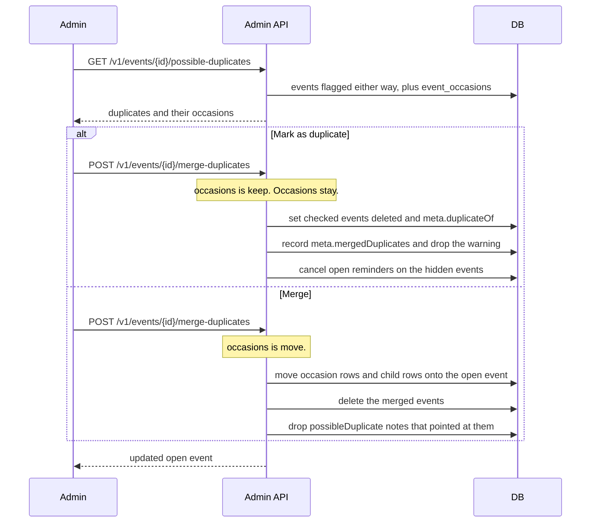

# Hide a possible duplicate in admin

Staff open an event and see other events that look like it, with those events' occasions. The admin
session cookie is required. The Tillfällen tab lists this event's rows from `event_occasions`, then
the possible duplicates.

Hiding a duplicate (`occasions: keep`) does not move occasions. The checked event becomes `deleted`,
so it leaves event lists, and `meta.duplicateOf` points at the open event. A later import of that
source id skips it. The open event stores the hidden events on `meta.mergedDuplicates`. It drops
`meta.possibleDuplicate` when that note pointed at one of the hidden events, so the duplicate
warning goes away. Public responses omit both fields.

Merging a duplicate (`occasions: move`) moves its occasion rows and child rows onto the open event,
then deletes it. A later import of that source id updates the open event, because the source ref
moves with it. Any surviving event drops `meta.possibleDuplicate` when that note pointed at the
merged event, so it leaves the possible-duplicates list.

