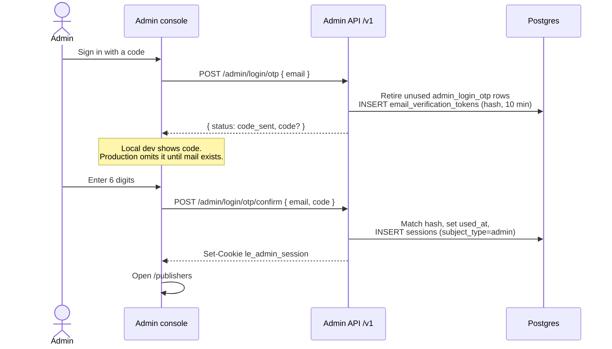

# Admin email one-time-code login

An admin can sign in with a 6-digit code instead of a password and authenticator. Password plus
TOTP stays available. The code is single-use, lasts 10 minutes, and allows five wrong guesses.
One email can request five codes per 15 minutes. Unknown emails get the same `code_sent` body
and no code.

The code is stored as a peppered hash on `email_verification_tokens`
(`purpose=admin_login_otp`). Without `ADMIN_OTP_PEPPER` the pepper is random for the process, so a
restart invalidates outstanding codes and a database dump is not a 6-digit rainbow table. Confirm
marks the row used only while it is still unused, then inserts the session in the same transaction.
Outside production the request response includes the raw code, because mail delivery is not wired.
`ADMIN_INCLUDE_LOGIN_OTP=true` includes it in production too. Leave that unset on a public host.

## Sequence

