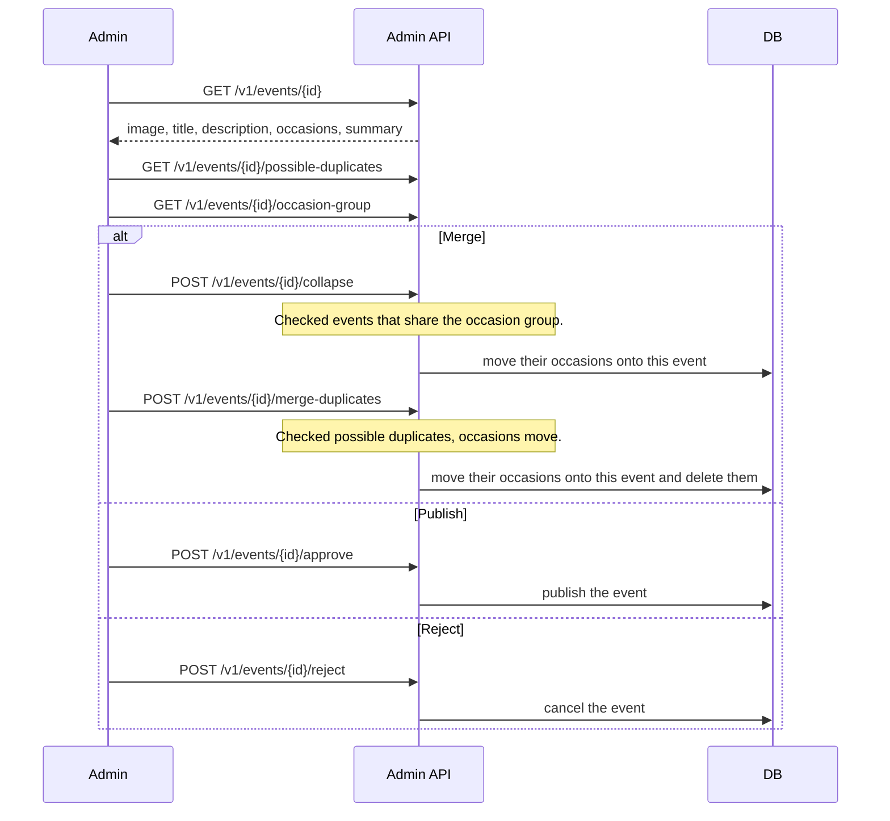

# Quick review

Staff open import review. The card shows the current event: image, title, description, occasions,
and summary. The occasion list shows 10 rows per page. Under that are the possible duplicates and the other events that share
`meta.possibleOccasionGroupId`. Both lists start checked. The admin session cookie is required.

Merge folds the checked occasion-group events into the open event, then folds the checked
duplicates the same way as Merge on the event page: their occasions move onto the open event and
the duplicates are deleted. An event that is in both lists is folded once, through the duplicate
merge. Each duplicate lists its occasions under the event row. Mark as duplicate on that row hides
that one event: status `deleted`, `meta.duplicateOf`, and its occasions stay. A row still
waiting for a scan keeps its empty publisher.
Publish and Reject use the same actions as the review list (`POST /events/{id}/approve` and
`POST /events/{id}/reject`).

