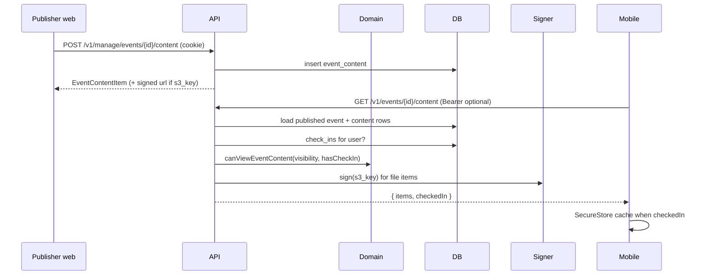

# Attendee content (signed URLs)

Check-in is off until an admin enables it. The publisher then adds extra text and links on the
event, plus maps/schedules/info/files under `/manage/events/{id}/content`. Attendees
`GET /v1/events/{id}/content` — public rows always; attendee text, attendee links, and `attendees`
rows only after check-in. File items get a short-lived URL from an injectable signer (memory in
tests/dev; CloudFront/S3 in prod). Mobile caches checked-in payloads in SecureStore for offline
venue use.

