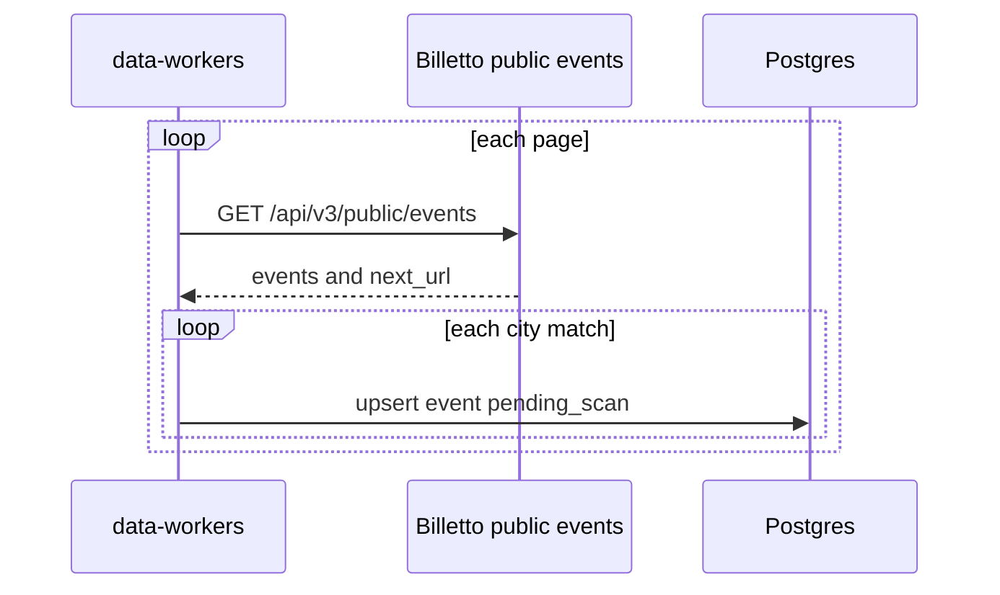

# Billetto import

Billetto is the `billetto` source. The worker calls the public event API. The key pair is
`BILLETTO_API_KEY` and `BILLETTO_API_SECRET_KEY`. It is not stored in `data_sources.config`. Send
it as `Api-Keypair: {key}:{secret}`.

The `data_sources` row is seeded disabled, trust `review`, schedule every 6 hours. A manual run
still fetches and saves. Saved events are `pending_scan` with `origin = imported`. The scan job
moves them to `in_review` or `published`. Flow: [event-scan.md](./event-scan.md).

The worker calls `GET https://billetto.se/api/v3/public/events?limit=100`, then follows `next_url`
while `has_more` is true, and saves each matching event before the next page. A redirect off
`billetto.se` fails that request. A `next_url` on another host fails that page. A 429 waits and
retries. Region and subregion filters still return events outside that place, so they are not sent.

A published event is kept when its city is one of the configured cities (Söderhamn, Bollnäs,
Hudiksvall, Ljusdal) and its country is Sweden. A draft or a canceled event is skipped. One public
event is one event, including a scheduled series. The external id is the event id. A `Z` time is
that instant. An event with no date is still saved.

The event URL, including its UTM query, is the ticket link and the source URL. The organizer id,
then the organizer name, identifies the organizer. Billetto is not an organizer key.
`amount_in_cents` is the major-unit price: 165 is 165 SEK, stored as 16500 minor units. A zero
price is free. The venue street, postcode, city, and point are stored on `meta.address` when the
API sends them. A point of 0, 0 is omitted. The import does not geocode.

