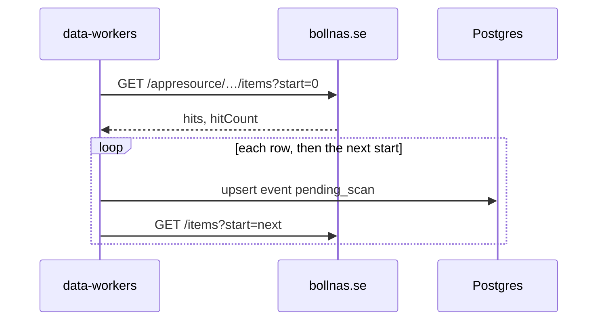

# Bollnäs kommun import

The public calendar on bollnas.se is the `bollnas-kommun` source. The page loads Soleil
`eventsCalendar` JSON. There is no API key.

The `data_sources` row is seeded disabled, trust `review`, schedule every 6 hours. A manual run
still fetches and saves. Saved events are `pending_scan` with `origin = imported`. The scan job
moves them to `in_review` or `published`. Flow: [event-scan.md](./event-scan.md).

`robots.txt` allows the calendar and the `/appresource/…/items` route, and disallows `jsessionid`
URLs. Pages are `GET {resourcePath}/items?start=0`, then `start=20`, and so on. The worker does
not request a session id.

Each JSON row is one showing. That row is saved before the next page is fetched. The item id is
the external id, so two showings of the same title stay separate. A `Z` time is that UTC instant.
A row with no date is still saved, with empty start and end.

`freeEntry` `Ja` is free (`priceAmount` 0, `meta.freeEntry`). A `Nej` row keeps a `kr` amount from
the text and otherwise leaves the price unknown. The event page is an info link. Ticket,
registration, Facebook, and Instagram URLs in the text keep those types.

The place line is split into venue, street, and town. Those go on `meta.address`. The JSON has no
coordinates, so the import does not geocode. The scan geocodes a missing point later. A contact
email in the text is the organizer key. Otherwise the venue name is the key.

