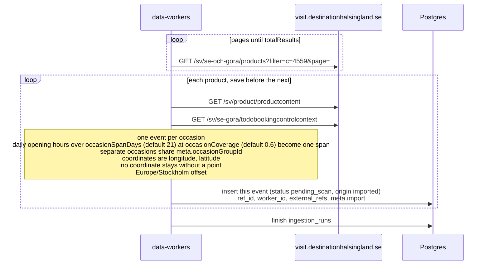

# Destination Hälsingland import

The public calendar on visit.destinationhalsingland.se is the `destination-halsingland` source.
There is no Citybreak API key. The worker calls the JSON the calendar page already loads. It does
not read HTML.

The `data_sources` row is seeded disabled, trust `review`, schedule every 6 hours. A manual run
still fetches and saves. Saved events are `pending_scan` with `origin = imported`. The scan job
moves them to `in_review` or `published`. Flow: [event-scan.md](./event-scan.md).

The list is `GET /sv/se-och-gora/products` with `filter=c=4559` (Evenemang i hela Hälsingland),
`sorting=st=a;so=a;split=hl`, and `pageSize=10`. Pages are 1-based and stop when the collected
count reaches `totalResults`. Each product then loads
`GET /sv/product/productcontent?cbisProductId=` and
`GET /sv/se-gora/todobookingcontrolcontext?cbisProductId=`. The booking response is every occasion
at once. A product with no occasions is still saved, with empty start and end. The event scan
fills both when it can read them from the text. That product is saved before the next product is
fetched.

List coordinates are `[longitude, latitude]`. A missing coordinate stays missing: the event can
still be opened by id, and it is left off the public map. A dense run of daily opening hours
longer than `occasionSpanDays` (default 21) that covers at least `occasionCoverage` of those days
(default 0.6) becomes one event (`externalId` `{id}:span`, `meta.collapsed`, every occasion on `meta.occasions`). A concert stays one event per
occasion, and each of those events stores the product id on `meta.occasionGroupId`. Both knobs
live on `data_sources.config`. Times use the Europe/Stockholm offset.

`priceAndCurrency` such as `200 SEK` is stored in öre. “Fritt inträde” sets the price to 0 and
`meta.freeEntry`. “Åldersgräns N” sets `meta.ageLimit`. The list `url` is the event page, including
when it is on another site. Ticket and info links come from the product text and
`externalBookingUrl`. Webbsida, Evenemangslänk, and Externa länkar in the product content are added
when that page is not already a link. A lookalike is flagged by the scan job, which sets
`meta.possibleDuplicate` and leaves the row `in_review`.
The organizer keys are the same for every worker: email, then an info-link host plus its path, then that host, then the
arena name. The source slug is used only when none of those exist. The scan job tries that list
and keeps the first publisher it finds.

Those requests go through `curl` over HTTP/1.1 with `PostmanRuntime/2.11.0`. Node's own HTTPS
client is answered with a Cloudflare challenge. The seeded row stays disabled until a manual
run succeeds.

