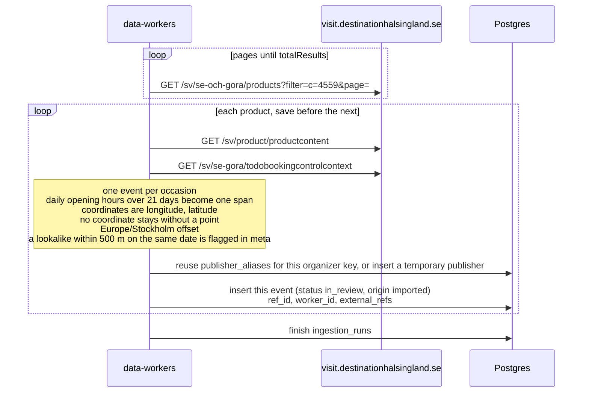

# Destination Hälsingland import

The public calendar on visit.destinationhalsingland.se is the `destination-halsingland` source.
There is no Citybreak API key. The worker calls the JSON the calendar page already loads. It does
not read HTML.

The `data_sources` row is seeded disabled, trust `review`, schedule every 6 hours. A manual run
still fetches and saves. Saved events are `in_review` with `origin = imported`.

The list is `GET /sv/se-och-gora/products` with `filter=c=4559` (Evenemang i hela Hälsingland),
`sorting=st=a;so=a;split=hl`, and `pageSize=10`. Pages are 1-based and stop when the collected
count reaches `totalResults`. Each product then loads
`GET /sv/product/productcontent?cbisProductId=` and
`GET /sv/se-gora/todobookingcontrolcontext?cbisProductId=`. The booking response is every occasion
at once. A product with no occasions is skipped. That product is saved before the next product is
fetched.

List coordinates are `[longitude, latitude]`. A missing coordinate stays missing: the event can
still be opened by id, and it is left off the public map. A dense run of daily opening hours
longer than 21 days becomes one event (`externalId` `{id}:span`). A concert stays one event per
occasion. Times use the Europe/Stockholm offset.

`priceAndCurrency` such as `200 SEK` is stored in öre. “Fritt inträde” sets the price to 0 and
`meta.freeEntry`. “Åldersgräns N” sets `meta.ageLimit`. Ticket and info links come from the
product text and `externalBookingUrl`. A lookalike within 500 m on the same Stockholm date is
saved as its own `in_review` event, and `meta.possibleDuplicate` points at the existing one.
The organizer key is an email when the text has one, otherwise the host of an info link,
otherwise the arena name. A publisher is reused only when this source already stored that same
organizer key.

Those requests go through `curl` over HTTP/1.1 with `PostmanRuntime/2.11.0`. Node's own HTTPS
client is answered with a Cloudflare challenge. The seeded row stays disabled until a manual
run succeeds.

