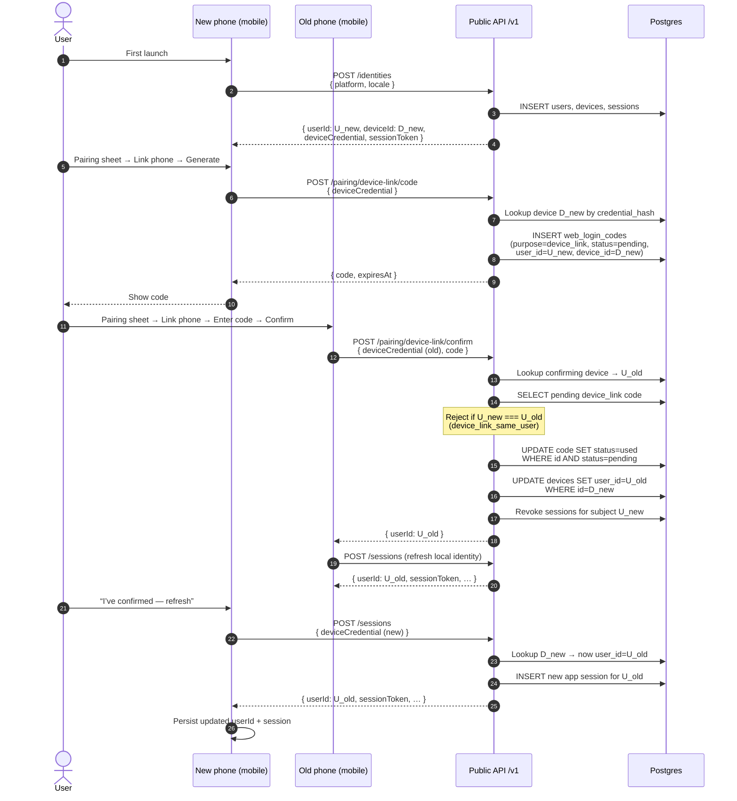

# Device linking

Recovery when the user gets a new phone: the **new** phone shows a pairing code; the **old**
(already trusted) phone confirms. Only the device that created the code is remapped onto the
confirming user. Codes use purpose `device_link` on `web_login_codes` (same alphabet/TTL as web
pairing).

## Sequence

## Need to know

- Only **`device_id` on the code** is remapped — not every device belonging to `U_new`.
- Code consume is conditional (`status = pending`) so concurrent confirms don’t double-succeed.
- After confirm, the new phone must call **`POST /sessions`** (or the in-app refresh control);
  its old app sessions for `U_new` were revoked.
- Same threat model as web pairing: a stolen live code can be confirmed by any valid device
  credential; keep TTL short (5 minutes) and rate-limit in production.
