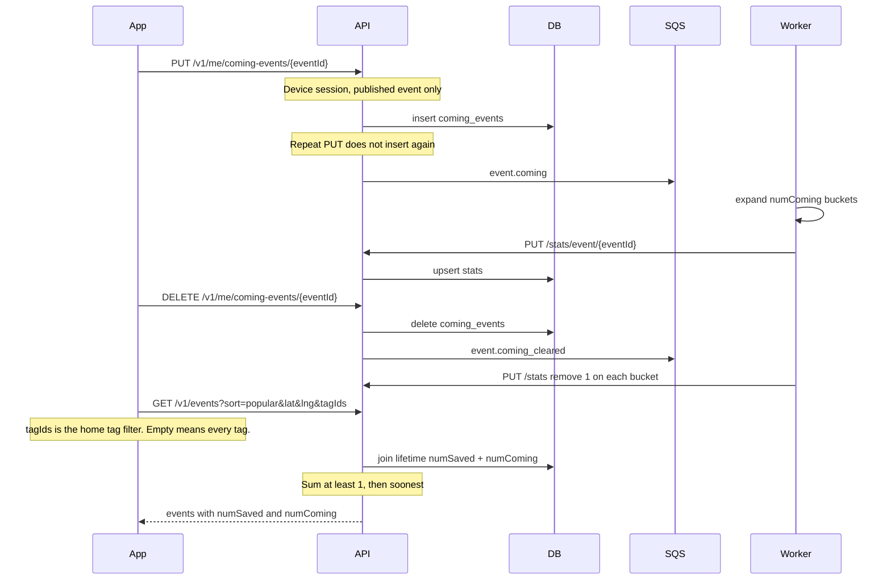

# I'm coming and popular events

Saving an event is the interested bookmark. "I'm coming" is a plan to attend. It is not another
save and it does not follow the event for notifications. The public list never names who saved
or who is coming. Counts live on `stats`.

A save uses the same path with `saved_events`, `event.saved` / `event.unsaved`, and `numSaved`.

Bucket keys for a mark on 13 Oct 2026 in Europe/Stockholm:

- `numComing`
- `numComing-2026-10-13`
- `numComing-w42`
- `numComing-2026-m10`
- `numComing-2026`

Week keys have no year. Someone who both saves and marks coming adds 1 to each counter, so
they count as 2 in `sort=popular`. Nightly reconcile sets the two lifetime keys from
`COUNT` of `saved_events` and `coming_events`. Calendar buckets are not rebuilt.
Deleting the user cascades both row tables.
