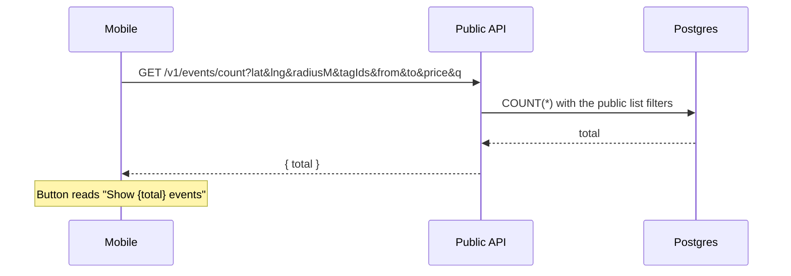

# Event counts

The Show events button on home categories, calendar filters, and the location menu shows how many
events that combination will list. The number uses the same rules as `GET /events`: published, a
point inside the radius, and not ended. A whole day stays through that calendar day. Tags match
when the event has any of the selected ones.

The request runs only while the sheet is open, and again when the draft changes. The app waits
briefly so a radius drag or several tag taps share one count. Sort and pages are not part of the
query.

Each button counts the list it will reveal:

- Home categories: the current place, the search text, and the tags selected in the sheet.
- Calendar filters: the current place and date range, plus the tags and price still in the sheet.
- Location: the place and radius still in the menu, plus the tags, date, price, and search text of
  the screen that opened it. On home, another place uses that place's saved tags.

## Cache plan

Counts are a database query for now. Valkey is the cache when this needs one. Store the total on
read, for a few minutes. Do not precompute combinations.

The key is the combination just requested:

- Coordinates rounded to about 100 metres, plus `radiusM`. Nearby fixes that land in the same
  spot share an entry. Saved places hit exactly. The list keeps using the exact place, and the
  button uses that same place, so the number stays the size of the list.
- Tag ids in sorted order.
- Date bounds.
- Price: any, free, or paid.

A text search is left uncached. The key space is open and those phrases rarely repeat.

A lock makes concurrent requests for the same key share one query. Nothing deletes entries when an
event is published or cancelled. The next expiry picks that up. A hot place can later add a
generation counter from the event write into the key, which drops the old totals without hunting
them down.
