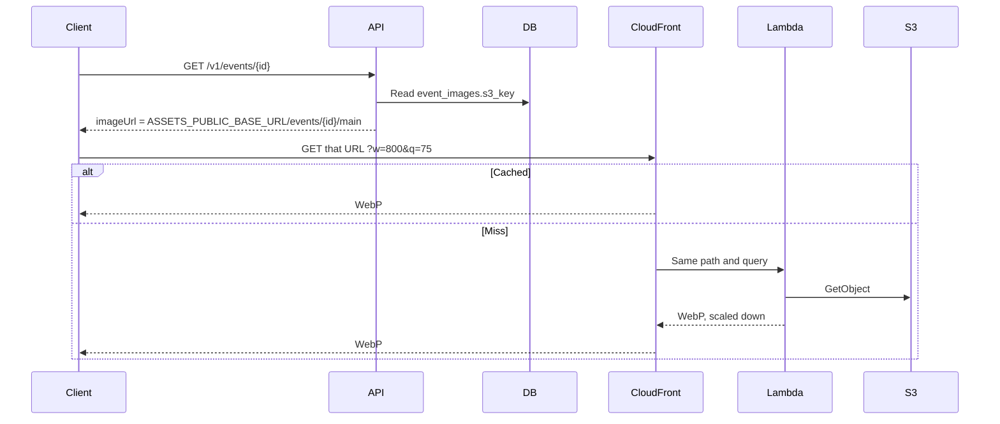

# Public event images

The API stores an object key on `event_images` and returns `imageUrl` as `ASSETS_PUBLIC_BASE_URL`
plus that key. It does not send the bytes. The app and the web page add `w` and `q`. A card asks
for 800, a poster for 1200, and an event hero for 1600. Quality is 75.

On AWS, CloudFront caches that size. A miss calls a Lambda function URL that only this
distribution may invoke. The function reads the private bucket, scales the image down to the
nearest of 400, 800, 1200, or 1600 pixels wide, and returns WebP at quality 60, 75, or 85. It
does not enlarge or crop. A missing `w` is 1600 and a missing `q` is 75.

The test server does the same resize. Caddy sends `assets.<domain>` to an image service, which
reads the original from Garage and returns WebP. It keeps a small memory cache of recent sizes.
Local Garage ignores `w` and `q` and serves the original file. A phone cannot open `*.localhost`,
so the app rewrites that URL to `GET /v1/assets/…` and the API fetches Garage.

