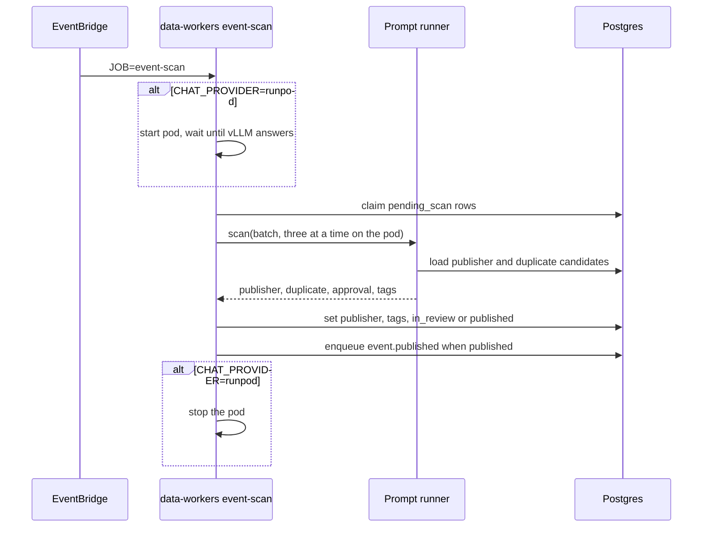

# Import scan

A data-worker insert saves a new event as `pending_scan` with no publisher. Organizer keys,
the organizer name, and the imported venue are stored on `meta.import`. Visit Söderhamn also
stores the arena name there. `events.venue_name` stays empty until the scan writes it. Public
responses omit that block.

EventBridge runs the data-workers task every 5 minutes with `JOB=event-scan`. Locally:

```bash
pnpm --filter @local-events/data-workers dev -- --job event-scan
pnpm --filter @local-events/data-workers dev -- --job event-scan --event <event-id>
pnpm --filter @local-events/data-workers dev -- --job event-scan --limit 1
```

`--event` claims that one `pending_scan` row when its lease is free. `--limit` claims that many rows instead of the default five. The scheduled task sets neither, so it keeps the batch of five.

The job claims rows whose lease is free and passes that batch to the prompt runner
in one call. Each row carries the event text and the organizer keys. The runner loads publisher
and duplicate candidates itself. With no `CHAT_PROVIDER` it calls local Ollama, one event at a
time. `CHAT_PROVIDER=chatgpt` uses `OPENAI_API_KEY`. `CHAT_PROVIDER=claude` uses
`ANTHROPIC_API_KEY`. `CHAT_PROVIDER=runpod` starts the pod `evnt-scan` in `CA-MTL-1`. A stopped pod with the same model, concurrency, GPU count, and all-reduce setting is started again. A start with no free GPU is retried until one is free, and that pod stays. The job waits until
vLLM is serving `Qwen/Qwen3-32B-AWQ` with thinking turned off. More than one GPU disables vLLM custom all-reduce, and a pod started without that flag is replaced. The job then drains the queue in claims of 50 with 50 scans at a time. One A40 holds about 10 full contexts, two hold about 30, and four hold the 50. Publisher
writes still happen after each batch, in claim order. The pod stops when the queue is empty.
`RUNPOD_API_KEY` and `RUNPOD_CHAT_KEY` are required. A second task exits while the first holds
the scan lock. `--event` and `--limit` still scan one batch.

For each event the Ollama runner:

1. Loads publisher candidates and chooses one from alias, email, website, and nearby name, or
   asks the worker to create a temporary publisher. A new temporary publisher is `pending_scan`.
   The event scan does not look it up. The publisher scan does that later.
2. Loads nearby events and looks for a duplicate (distance, 30 minutes, then id, event link, any
   link, or title).
3. Approves the content. This step always approves until a later prompt can reject harmful, spam,
   or adult content.
4. Asks the configured chat model for up to five catalog tags.
   Those tags replace any the event already has.
   Steps the model lists from the description are stored on `meta.instructions`.
   When the event has no start and no end, the model also returns both instants. Those
   replace the empty dates. A range that is missing one side is ignored.
   The tool-calling scan may call `fetchEventPage`. That opens one https page:
   the source URL, then a ticket link, then an info link, then a Facebook page.
   A page on visit.destinationhalsingland.se is fetched with curl over HTTP/1.1.
   The model uses the page text for tags, instructions, the summary, and
   missing dates, and for the address. The model returns that address in the scan JSON.
   A scraped point is kept. When the event has no point, the scraped address is geocoded,
   and the address from that JSON is used only when the import stored none. A street, or a
   postcode with a city, is geocoded. When that finds nothing, or the address is only a city, the city is geocoded. Only a hit in Sweden is kept. The model does not
   supply coordinates. The model also returns possible venue names. Importers leave
   `events.venue_name` empty and store the name on `meta.import.venueName`. Visit Söderhamn
   also stores the arena name on `meta.import.arenaName`. The scan prompt passes the arena
   name, then that venue name, as the location. The highest rank above 80 is written. When
   the model returns none, the arena name is written, then the imported venue name. A later
   import does not clear a venue the scan already wrote. A later import keeps that address,
   and keeps its point when the new address has none.

The worker writes the publisher, tags, and `meta.possibleDuplicate`, then sets the status.
A duplicate ranked over 90 as another showing also stores `meta.possibleOccasionGroupId` on the
scanned event and on each of those duplicates. An `occasionGroupId` already on one of them is
reused. Otherwise an existing `possibleOccasionGroupId` is reused, and a new id is created only
when none is set. Public responses omit the field.

| Result | Status |
| --- | --- |
| Possible duplicate | `in_review` |
| Content scan does not approve | `in_review` |
| Temporary publisher, publisher that is not `published`, or source trust `review` | `in_review` |
| Approved, publisher status `published`, not temporary, source trust `auto_publish` | `published` |

`published` enqueues `event.published` and schedules the publisher's import reminders as approved.
`in_review` schedules those reminders as pending when the publisher status is `published` and a plan is set.
A model failure releases the lease and leaves that row `pending_scan`. The other rows in the batch
still finish. An admin can send an imported `in_review` event back with `POST /v1/events/{id}/rescan`.
That sets `pending_scan`, clears the scan lease, and cancels open reminders so the next run can claim it.


