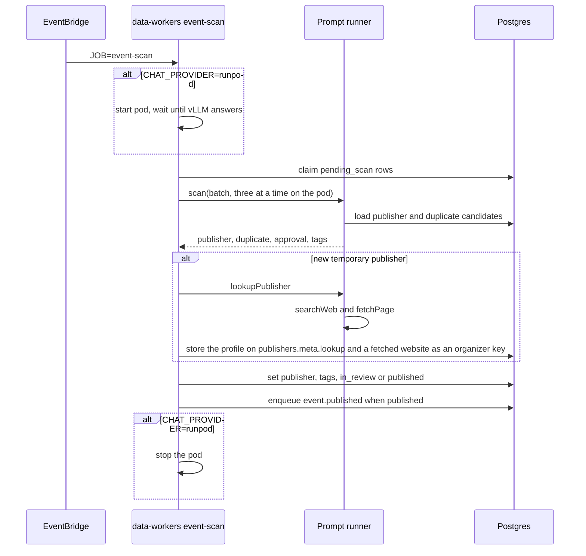

# Import scan

A data-worker insert saves a new event as `pending_scan` with no publisher. Organizer keys and
the organizer name are stored on `meta.import`. Public responses omit that block.

EventBridge runs the data-workers task every 5 minutes with `JOB=event-scan`. Locally:

```bash
pnpm --filter @local-events/data-workers dev -- --job event-scan
pnpm --filter @local-events/data-workers dev -- --job event-scan --event <event-id>
pnpm --filter @local-events/data-workers dev -- --job event-scan --limit 1
```

`--event` claims that one `pending_scan` row when its lease is free. `--limit` claims that many rows instead of the default five. The scheduled task sets neither, so it keeps the batch of five.

The job claims rows whose lease is free and passes that batch to the prompt runner
in one call. Each row carries the event text and the organizer keys. The runner loads publisher
and duplicate candidates itself. With no `CHAT_PROVIDER` it calls local Ollama, one event at a
time. `CHAT_PROVIDER=chatgpt` uses `OPENAI_API_KEY`. `CHAT_PROVIDER=claude` uses
`ANTHROPIC_API_KEY`. `CHAT_PROVIDER=runpod` starts the pod `evnt-scan` in `CA-MTL-1`, waits until
vLLM answers, then drains the queue in batches of five with three scans at a time. Publisher
writes still happen after each batch, in claim order. The pod stops when the queue is empty.
`RUNPOD_API_KEY` and `RUNPOD_CHAT_KEY` are required. A second task exits while the first holds
the scan lock. `--event` and `--limit` still scan one batch.

For each event the Ollama runner:

1. Loads publisher candidates and chooses one from alias, email, website, and nearby name, or
   asks the worker to create a temporary publisher. A new temporary publisher runs a second
   prompt that may call `searchWeb` and `fetchPage`. The returned profile is stored on
   `publishers.meta.lookup`. A website from a page that was fetched is also stored as an
   organizer key. That prompt runs only when `BRAVE_API_KEY` is set. A failed
   lookup leaves the temporary publisher as it is.
2. Loads nearby events and looks for a duplicate (distance, 30 minutes, then id, event link, any
   link, or title).
3. Approves the content. This step always approves until a later prompt can reject harmful, spam,
   or adult content.
4. Asks the configured chat model for up to five catalog tags scored above 90 when the event has no tags yet.
   Steps the model lists from the description are stored on `meta.instructions`.

The worker writes the publisher, tags, and `meta.possibleDuplicate`, then sets the status.
A duplicate ranked over 90 as another showing also stores `meta.possibleOccasionGroupId` on the
scanned event and on each of those duplicates. An `occasionGroupId` already on one of them is
reused. Otherwise an existing `possibleOccasionGroupId` is reused, and a new id is created only
when none is set. Public responses omit the field.

| Result | Status |
| --- | --- |
| Possible duplicate | `in_review` |
| Content scan does not approve | `in_review` |
| Temporary publisher, unverified publisher, or source trust `review` | `in_review` |
| Approved, verified, not temporary, source trust `auto_publish` | `published` |

`published` enqueues `event.published` and schedules the publisher's import reminders as approved.
`in_review` schedules those reminders as pending when the publisher is verified and a plan is set.
A model failure releases the lease and leaves that row `pending_scan`. The other rows in the batch
still finish.


