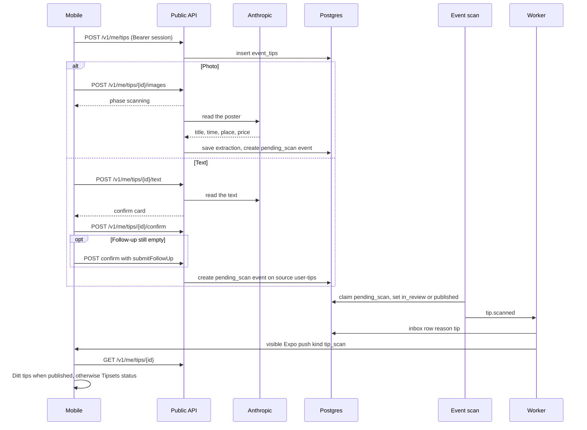

# Event tips

A person can tip the app about an event that is missing. The tip stays private until an admin
publishes the event the scan creates. Poster reading uses Anthropic. The later event scan is the
same import scan as every other source.

Layout reference: [event-tip-ui.png](../event-tip-ui.png) and
[event-tip-status-ui.png](../event-tip-status-ui.png).

- Auth is the device session. A tip is readable only by that user.
- `user-tips` is trust `review` and stays disabled, so the scan lands the event in `in_review`
  unless that source is later switched to `auto_publish` and the publisher is already published.
- The push ignores quiet hours and the daily cap. The copy says the event was added only when
  the scan published it. While the app is open the banner is hidden and the tip screen opens.
  A tap from the lock screen opens that same screen.
- Deleting the user removes `event_tips`, `tip_messages`, and `tip_images`. The event stays.
