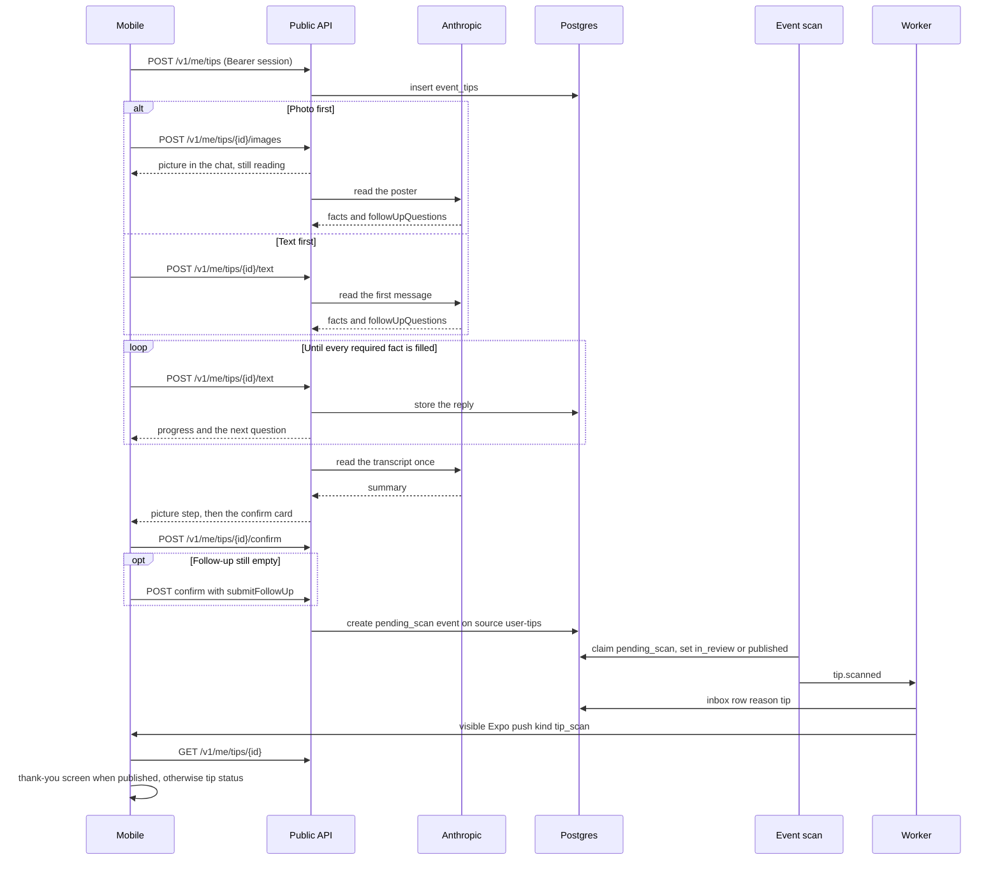

# Event tips

A person can tip the app about an event that is missing. The tip stays private until an admin
publishes the event the scan creates. Poster reading uses Anthropic. The later event scan is the
same import scan as every other source.

Layout reference: [event-tip-ui.png](../event-tip-ui.png) and
[event-tip-status-ui.png](../event-tip-status-ui.png).

- A tip stays in the chat until title, start date, start time, end date, end time, place, price,
  link, and description are filled. A value the model found is confirmed first, one fact at a
  time, with yes and no. Yes keeps it. No opens the control for that fact, already filled in.
  A value the person accepts or replaces is not asked again. Replies stay on the tip. The model is
  not called again until every required fact is filled, and then the transcript is read once so the
  summary can be written. A title, place, or description the person types is checked when they
  continue. Text that is not an event stays unsent, and the chat shows a warning. The first message
  is refused the same way. Yes, a picked date, and a picked time are not checked that way. A clock the tip already states fills
  that time. A date with no clock still asks for the time. The date steps use the calendar. The time steps use a
  wheel, and the person can answer that they do not know. The chat does not ask for a tag or a
  category. The model receives the tag catalog and returns the names that fit. The confirm screen
  shows those tags under the summary. The chat says it is verifying, then opens that screen.
  Opening a saved tip shows that summary first. Continue returns to the chat while a fact is still
  missing, and the chat opens at the latest step. Change returns to the chat, asks which fact to replace, and opens that control. Cancel on that step returns to the summary without sending. Sending the new
  value returns to the summary. A picture is the last step. Every upload is checked first, and a
  harmful picture or one above a PG-13 level is refused with a warning and is not stored. A picture already on the tip is
  confirmed there: yes keeps it, and choosing another adds that picture to the chat. When the facts
  are already complete, that new picture is the last step: the chat verifies and opens the summary.
  Change can replace the picture the same way. The picture comes from the camera or the photo
  library. A picture chosen on the first
  screen is stored in the public assets bucket (Garage locally, S3 in production) and is read into
  that same chat: the photo shows with a spinner, and a bubble says the details are being read.
  The model names the missing fact on the first read. Later replies are applied on the tip, and the chat shows that
  control. `link: none`, `price: free`, `startTime: none`, `endDate: none`, `endTime: none`, and
  `image: none` count as answered. A link is stored as a host and path, without `http://` or
  `https://`. A question that asks whether a link exists has yes and no. A question that asks
  for the address stays a text field. The bar counts how many of
  those nine facts are filled. When they are all present, the model writes a short summary.
  That summary is the lead on the confirm screen and is stored on the event. The event description
  is that written description. The chat lines are stored on `meta.tip`, which public responses omit,
  and the scan prompt receives those lines along with the written description.
- Auth is the device session. A tip is readable only by that user.
- `user-tips` is trust `review` and stays disabled, so the scan lands the event in `in_review`
  unless that source is later switched to `auto_publish` and the publisher is already published.
  Publishing that event stores `published` on the tip and sends the published notice, so the status step reads “Granskad och publicerad”.
- The push ignores quiet hours and the daily cap. The copy says the event was added only when
  the scan published it. While the app is open the banner is hidden. A published tip opens the
  thank-you screen, and any other result opens the tip status. A tap from the lock screen does
  the same. A tap on the inbox row opens the thank-you screen when the tip is published, and the tip status in a bottom sheet otherwise.
- Deleting the user removes `event_tips`, `tip_messages`, and `tip_images`. The event stays.
