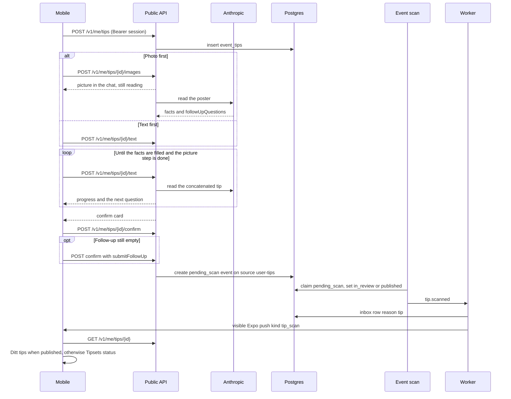

# Event tips

A person can tip the app about an event that is missing. The tip stays private until an admin
publishes the event the scan creates. Poster reading uses Anthropic. The later event scan is the
same import scan as every other source.

Layout reference: [event-tip-ui.png](../event-tip-ui.png) and
[event-tip-status-ui.png](../event-tip-status-ui.png).

- A tip stays in the chat until title, start date, start time, end date, end time, place, price,
  link, and description are filled. A clock the tip already states fills that time, so the chat
  does not ask for it again. A date with no clock still asks. The date steps use the calendar. The time steps use a text
  field, and the person can answer that they do not know. The chat does not ask for a tag or a
  category. The model receives the tag catalog and returns the names that fit. The confirm screen
  shows those tags under the summary. A picture is the last step. A picture chosen on the first
  screen is stored in the public assets bucket (Garage locally, S3 in production) and is read into
  that same chat: the photo shows with a spinner, and a bubble says the details are being read.
  Each reply is appended and read again. The model names the missing fact and the chat shows that
  control. `link: none`, `price: free`, `startTime: none`, `endDate: none`, `endTime: none`, and
  `image: none` count as answered. A link is stored as a host and path, without `http://` or
  `https://`. A question that asks whether a link exists has yes and no. A question that asks
  for the address stays a text field. The bar counts how many of
  those nine facts are filled. When they are all present, the model writes a short summary.
  That summary is the lead on the confirm screen and is stored on the event.
- Auth is the device session. A tip is readable only by that user.
- `user-tips` is trust `review` and stays disabled, so the scan lands the event in `in_review`
  unless that source is later switched to `auto_publish` and the publisher is already published.
- The push ignores quiet hours and the daily cap. The copy says the event was added only when
  the scan published it. While the app is open the banner is hidden and the tip screen opens.
  A tap from the lock screen opens that same screen.
- Deleting the user removes `event_tips`, `tip_messages`, and `tip_images`. The event stays.
