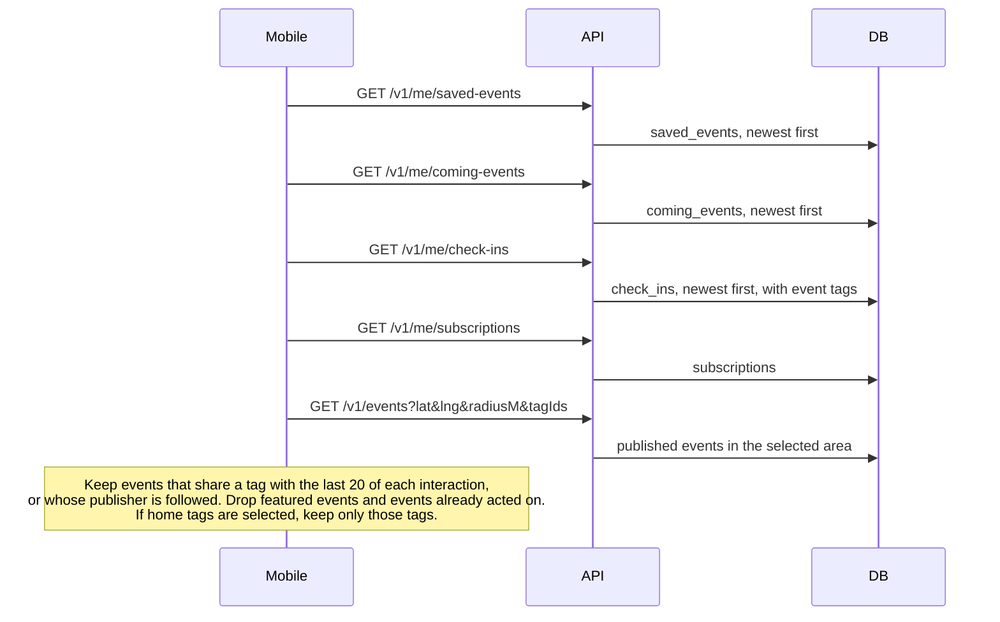

# For you

Home **För dig** recommends upcoming events from what the user has already done. There is no time
window: the newest interactions count, however old they are.

The upcoming list on home is the full catalog, so a For you card may appear there too.
