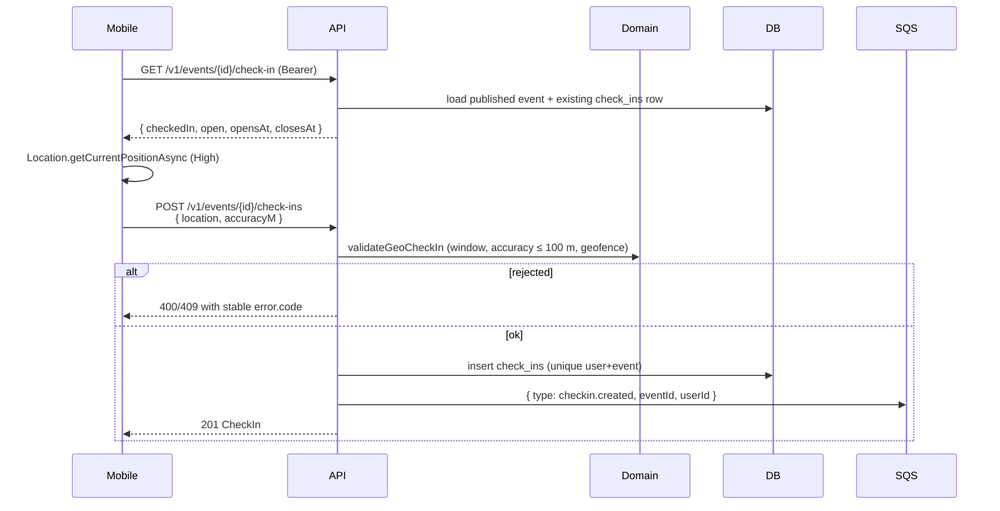

# Physical geofence check-in

Mobile requests a high-accuracy location and posts it to the API. Domain rules decide whether
the check-in is accepted; a successful write enqueues `checkin.created` for the worker (stats later).

Venue QR / digital codes are a later Phase 4 slice.
