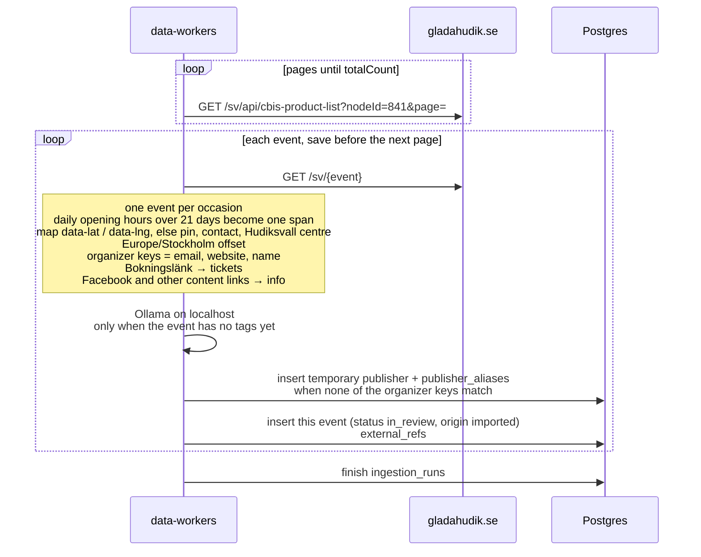

# Glada Hudik import

The public calendar on gladahudik.se is the `glada-hudik` source. There is no Citybreak API key.
The `data_sources` row is seeded disabled, trust `review`, schedule every 6 hours. A manual run
still fetches and saves. Saved events are `in_review` with `origin = imported`.

The list request sends only `nodeId` and `page`. `robots.txt` disallows filtered queries
(`order`, `occasion`, `filter`, `search`, `categories`, `geo`, `arena`).

A dense run of daily opening hours longer than 21 days becomes one event (`externalId`
`cbis:{id}:span`). A concert, a film week, or a monthly circle stays one event per occasion.
The hero is the event page `og:image`. `data-lat` and `data-lng` on the page map become the
event point. A page without that map is geocoded from the location pin under the price, then
the contact address (and, if that misses, the contact town). A hit is kept only when it falls
inside Hudiksvall municipality. Otherwise the event uses Hudiksvall centre
(61.728161, 17.105575). Lookups go to the public Photon geocoder, one unique query at a time.
A digital showing stays without a point.

A booking link (`Bokningslänk`) is `tickets`. Event, website, and Facebook links in
the description or contact block are `info`. The destination site’s footer links are left out.
Organizer key is the contact email when the page has one.

The worker reads the whole list first. It then takes one event at a time: the event page, then
up to five tags from a local Ollama model (`qwen3:32b` unless `OLLAMA_MODEL` is set). The
answer has to be ids already in the database, each with a fit score above 90. That event is
saved before the next page is fetched. An event that already has tags keeps them and is not
sent to the model again. No running model, or `OLLAMA_DISABLED=1`, means a new event is saved without a tag.

