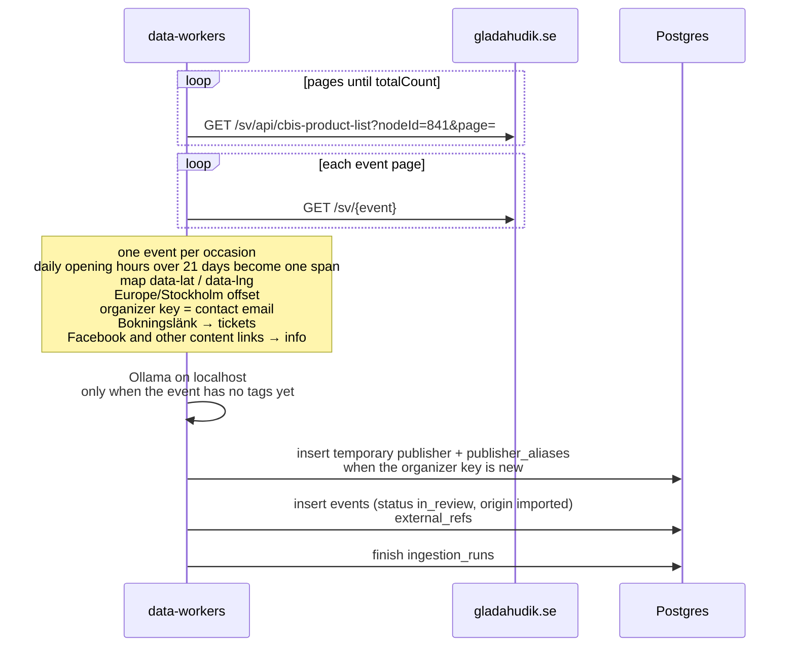

# Glada Hudik import

The public calendar on gladahudik.se is the `glada-hudik` source. There is no Citybreak API key.
The `data_sources` row is seeded disabled, trust `review`, schedule every 6 hours. A manual run
still fetches and saves. Saved events are `in_review` with `origin = imported`.

The list request sends only `nodeId` and `page`. `robots.txt` disallows filtered queries
(`order`, `occasion`, `filter`, `search`, `categories`, `geo`, `arena`).

A dense run of daily opening hours longer than 21 days becomes one event (`externalId`
`cbis:{id}:span`). A concert, a film week, or a monthly circle stays one event per occasion.
The hero is the event page `og:image`. `data-lat` and `data-lng` on the page map become the
event point. A booking link (`Bokningslänk`) is `tickets`. Event, website, and Facebook links in
the description or contact block are `info`. The destination site’s footer links are left out.
Organizer key is the contact email when the page has one.

After the pages are read, a local Ollama model (`qwen3:32b` unless `OLLAMA_MODEL` is set) may
choose one tag from the tags already in the database. The answer has to be one of those ids.
An event that already has tags keeps them, and that product is not sent to the model again.
No running model means a new event is saved without a tag.

