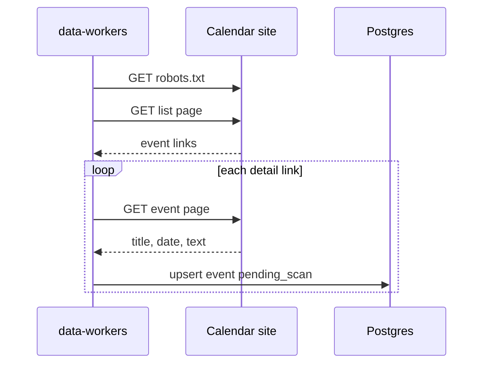

# HTML calendar import

`html-calendar` is one adapter. Each site is its own `data_sources` row, with the list URL and
the CSS selectors in `config`. The seeded rows are Hälsinglands museum, Systrarna Söderström,
Folkteatern Gävleborg, Ovanåker, and ABF Hälsingland. They are disabled, trust `review`, schedule every 6 hours.
A manual run still fetches and saves. Saved events are `pending_scan` with `origin = imported`.

The worker reads the list page, follows each detail link, and saves that event before the next
page is fetched. The external id is the page path plus its query, so two events on the same path
stay distinct. A next link has to be an `a` with an `href`. The worker stays on the list host,
skips a `jsessionid` URL, and skips a path `robots.txt` disallows. A redirect to another host
fails the list and skips that detail page.

Paragraphs, headings, and list items in the description become separate lines. A line break
stays one line. The links are still read from the HTML.

A date with a numeric offset is that instant. A date with no zone is Europe/Stockholm. A date
with no clock, and a clock with no end, is that instant for both start and end. Several dates in
the date field are occasions. A page with no readable date is still saved. The import does not
geocode.

