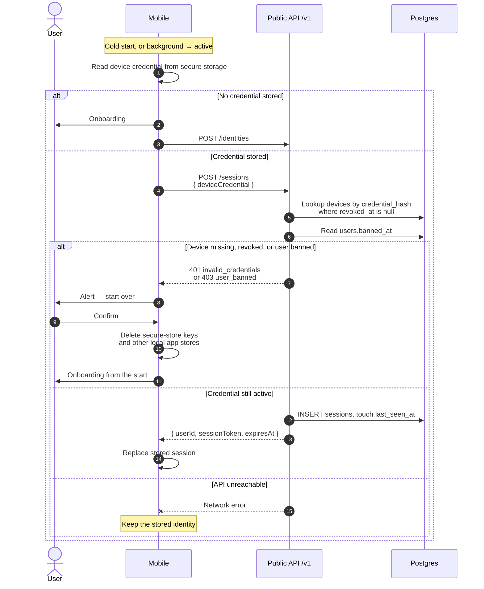

# Rejected device identity

The mobile app proves its stored device credential on launch and whenever it returns to the
foreground. A deleted user, a revoked device, or a banned user cannot keep using that install.
The person confirms an alert, then the app deletes on-device stores and runs onboarding again.

A network failure is not a rejection: the stored credential stays, and the app keeps working
offline with the session it already has.

## Sequence

## Notes

- Session exchange is the check. `requireUserSession` on an existing token would still succeed
  after a device revoke until that token expired, and would miss a deleted device.
- Confirmation wipes the known secure-store keys (identity, onboarding, prompts, home filters)
  via `clearLocalAppData`, then shows the onboarding carousel. The next continue creates a new
  anonymous identity.
- The same rejection during a later session refresh (token inside five minutes of expiry) opens
  the same alert. It does not silently create a replacement identity.
