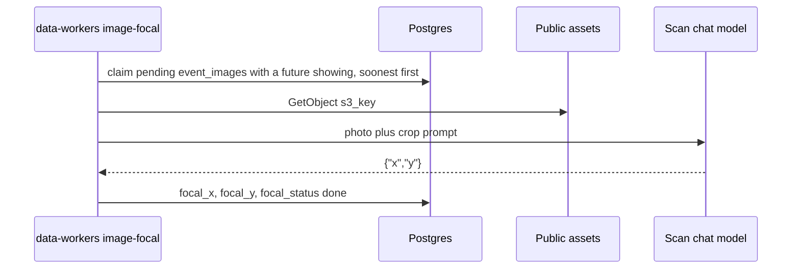

# Image focal point

An event photo is stored whole. Explore crops it to fill a tall phone screen, so the app needs a
point that should stay in frame. `focal_x` is the fraction from the left. `focal_y` is the fraction
from the top. Both are empty until this job writes them.

A new `event_images` row is `pending`. Replacing the file clears any point and returns the row to
`pending`. A poster is left `pending` because that image is shown whole. The job only claims a photo
whose event still has a showing, soonest start first. A timed showing stays until it ends. A whole
day, the same start and end, stays through that calendar day. An event with no remaining showing
is left `pending`.

EventBridge runs the data-workers task every 5 minutes with `JOB=image-focal`. Locally:

```bash
pnpm --filter @local-events/data-workers dev -- --job image-focal
pnpm --filter @local-events/data-workers dev -- --job image-focal --image <image-id>
pnpm --filter @local-events/data-workers dev -- --job image-focal --limit 1
```

`--image` claims that one pending row when its lease is free and the event still has a showing.
`--limit` claims that many rows instead of the default five. The scheduled task sets neither, so it
keeps the batch of five.

The job uses the same chat settings as the import scan. With no `CHAT_PROVIDER` it calls local
Ollama. `CHAT_PROVIDER=chatgpt` uses `OPENAI_API_KEY`. `CHAT_PROVIDER=claude` uses
`ANTHROPIC_API_KEY`. `CHAT_PROVIDER=runpod` holds the scan lock, starts the scan pod, drains
pending images, and stops the pod when the run ends. The model has to accept images.

For each claimed image the job reads the object from the public assets bucket and sends it with
the crop prompt. The model returns JSON `{"x": number, "y": number}`.

| Result                                                                                    | `focal_status`                  |
| ----------------------------------------------------------------------------------------- | ------------------------------- |
| A point from 0 to 1                                                                       | `done`                          |
| An answer that is not a point, a missing file, an unsupported type, or a file over 4.5 MB | `failed`                        |
| The chat request times out, the model is unreachable, or the asset store errors           | stays `pending`, lease released |

`focal_output` keeps the model JSON, or a short error such as `missing`.


