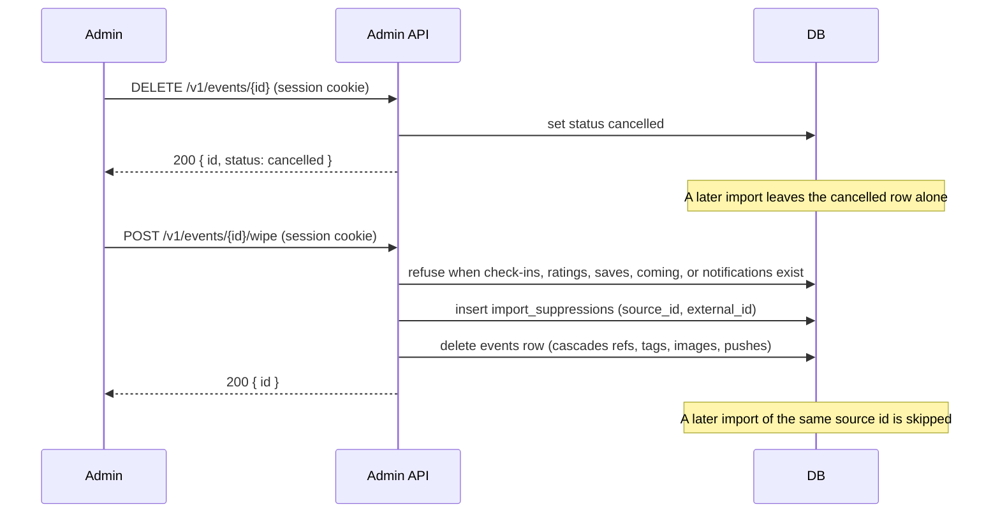

# Delete or wipe an import from review

An admin session cookie is required. Publish and reject stay `POST /v1/events/{id}/approve` and
`POST /v1/events/{id}/reject`. Delete and wipe are only for imported events still `in_review`.

