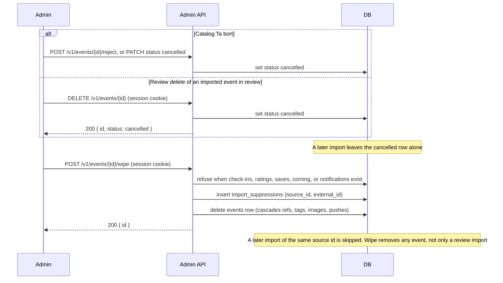

# Delete or wipe an event

An admin session cookie is required. Publish and reject stay `POST /v1/events/{id}/approve` and
`POST /v1/events/{id}/reject`.

On `/events/manage`, Ta bort asks for confirmation. Leaving the box unchecked cancels every selected
event and keeps the row: an event in review is rejected, and any other status is patched to
`cancelled`. Checking Ta bort permanent calls wipe. Import review still deletes or wipes only an
imported event that is `in_review`. Wipe itself removes any event and refuses when someone has
checked in, saved, rated, or been notified.

