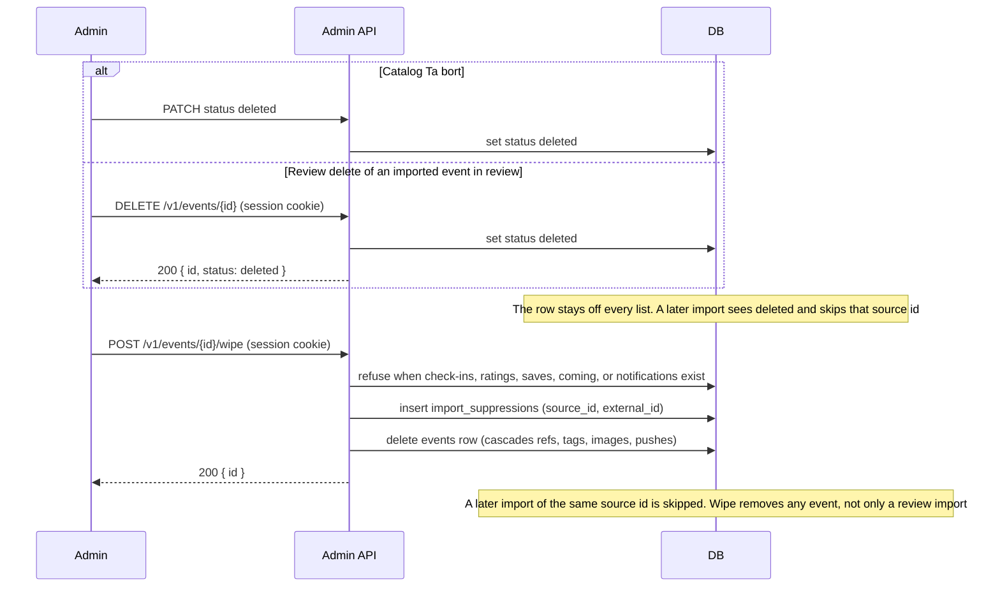

# Delete or wipe an event

An admin session cookie is required. Publish and reject stay `POST /v1/events/{id}/approve` and
`POST /v1/events/{id}/reject`.

On `/events/manage`, Ta bort asks for confirmation. Leaving the box unchecked sets the status to
`deleted` and keeps the row, so the event leaves every list. A later import finds that source id,
sees `deleted`, and skips it. Checking Ta bort permanent calls wipe. Import review delete does the
same status change for an imported event that is `in_review`. Wipe itself removes any event and
refuses when someone has checked in, saved, rated, or been notified.

