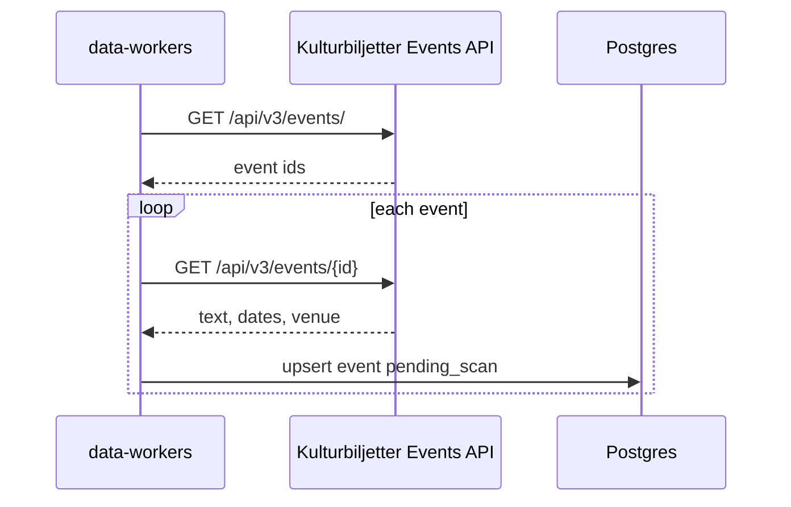

# Kulturbiljetter import

Kulturbiljetter is the `kulturbiljetter` source. The worker calls Events API v3. The key is
`KULTURBILJETTER_API_KEY`. It is not stored in `data_sources.config`. Send it as
`Authorization: Token {key}`.

The `data_sources` row is seeded disabled, trust `review`, schedule every 6 hours. A manual run
still fetches and saves. Saved events are `pending_scan` with `origin = imported`. The scan job
moves them to `in_review` or `published`. Flow: [event-scan.md](./event-scan.md).

The list is national and has no city. The worker calls `GET https://kulturbiljetter.se/api/v3/events/`,
then `GET /api/v3/events/{event_id}` for each id, and saves that event before the next one is
fetched. A redirect off `kulturbiljetter.se` fails that request. A missing event is skipped.

A showing is kept when its venue city is one of the configured cities (Söderhamn, Bollnäs,
Hudiksvall, Ljusdal). One product is one event. Each remaining date is an occasion. The external
id is the event id. A unix time is that instant. The API sends a start and no end, so the start
and end are that same instant. That is a whole day, including when `date_only` is true. An event
with no date is still saved.

The checkout URL is a ticket link. The Kulturbiljetter event page is an info link. The organizer
id, then the organizer name, identifies the organizer. The ticket shop is not an organizer key.
`price_min` is the price in minor units. A zero price is free. The venue street and city are
stored on `meta.address` when the showings share one place. The API sends no coordinates. The
import does not geocode.

