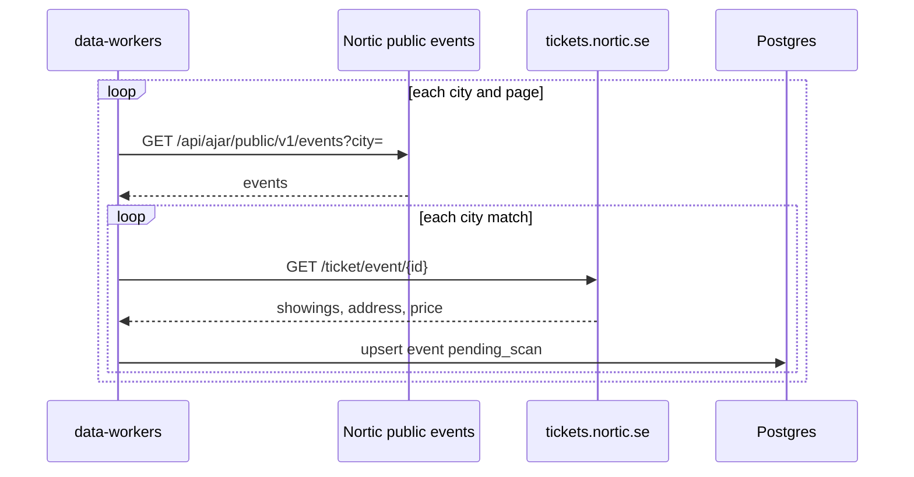

# Nortic import

Nortic is the `nortic` source. The worker calls the public events API. The key is
`NORTIC_API_KEY`. It is not stored in `data_sources.config`. Send it as `X-Api-Key` on
`services.nortic.se` only.

The `data_sources` row is seeded disabled, trust `review`, schedule every 6 hours. A manual run
still fetches and saves. Saved events are `pending_scan` with `origin = imported`. The scan job
moves them to `in_review` or `published`. Flow: [event-scan.md](./event-scan.md).

The worker calls `GET https://services.nortic.se/api/ajar/public/v1/events?city=` for each
configured city, then the next page, and saves each matching event before the next one. A redirect
off `services.nortic.se` fails that request. `www.nortic.se` disallows `/api`, so the worker does
not call that host.

An event is kept when its city is one of the configured cities (Söderhamn, Bollnäs, Hudiksvall,
Ljusdal). One product is one event. The external id is the event id. The worker then reads
`https://tickets.nortic.se/ticket/event/{id}` and no other path on that host. `robots.txt` there
disallows `/ticket/ajax` and `/ticket/checkout`. A redirect off `tickets.nortic.se` fails that
page. A disallowed or missing ticket page leaves the list times in place.

Each showing on the ticket page is an occasion. A clock there is Europe/Stockholm. The visible
range is the start and the end, including a showing that ends after midnight. A `Z` time from the
list is that instant and is used only when the ticket page has no showing. The offer price is
major-unit SEK: 195 is 195 SEK, stored as 19500 minor units. The lowest offer is kept. A zero
price, or a description that says the event is free, is free. The street, postcode, and city are
stored on `meta.address`. The list sends no coordinates. The import does not geocode.

The ticket page is the ticket link and the source URL. The organizer id, then the organizer name,
identifies the organizer. Nortic is not an organizer key. The hero image is the file the branding
URL redirects to. A private address is omitted.

