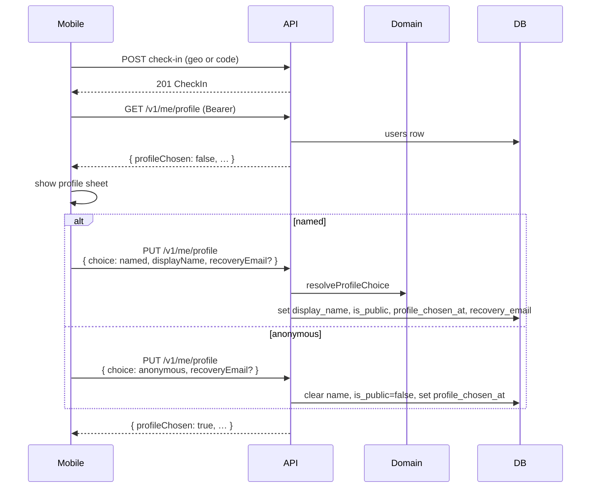

# Profile prompt at first check-in

After a successful check-in, mobile loads `GET /v1/me/profile`. If `profileChosen` is false,
it offers named vs anonymous (optional recovery email). Choice is persisted with
`profile_chosen_at` so the prompt does not repeat.

Recovery email verification (one-time code → fresh device credential) remains a later slice;
email is never shown on public surfaces.
