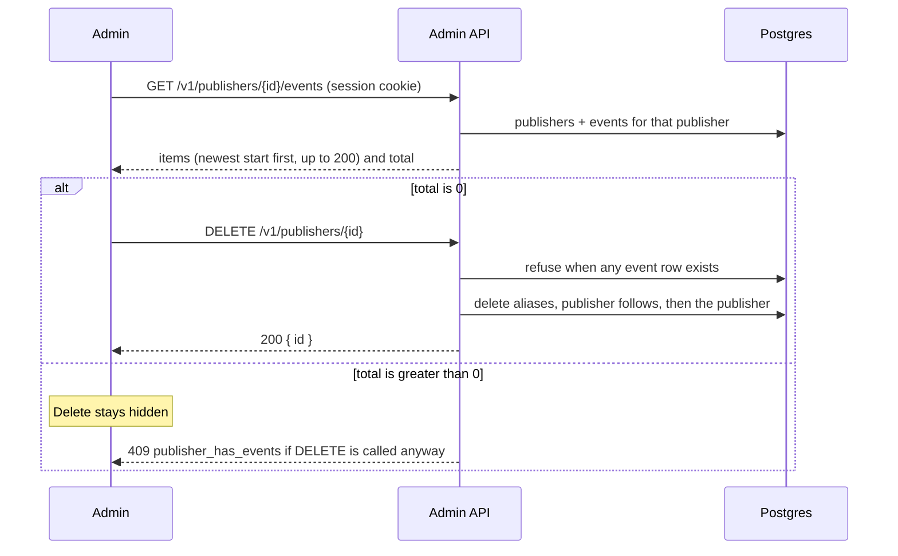

# Delete an empty publisher

The admin publisher page lists that publisher's events, including each event id, so a staff
member can see whether the publisher is unused. Delete is offered only when the list total is 0.
The temporary publisher list shows each publisher id and offers the same delete when the event
count is 0. The all-publishers list shows each id.

