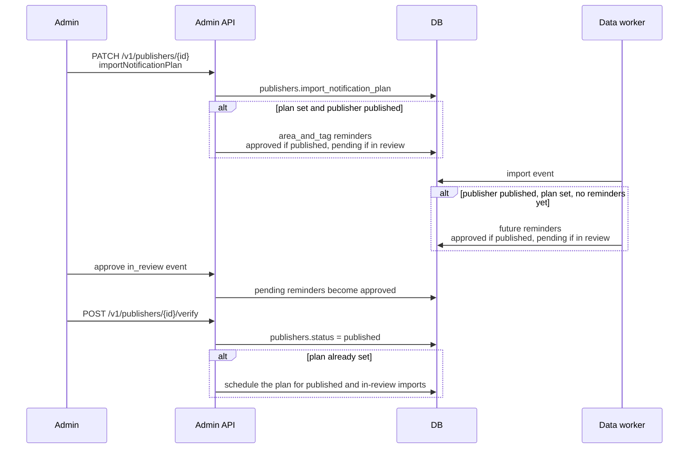

# Publisher import notifications

Admin chooses how a script-imported event is notified. Nothing sends no import notification.
A marketing plan is scheduled only when the publisher status is `published`. The publisher page
lists the notifications in each plan. Every plan except simple can also send one notification as
soon as the event is published. That message is due immediately. Simple never includes it.

Reminders whose send time is already past are left out. The publish notification is not a reminder.
A new import includes it when the option is on, and an event still in review keeps it pending until
publish. Saving the plan does not send it for an event that is already published. A second import, or saving the plan
again, does not add another set once that event has a non-cancelled `area_and_tag` message.
`pending` reminders are not sent. Publishing the event approves them, and the worker sends
only when the message is `approved` and the event is `published`.
