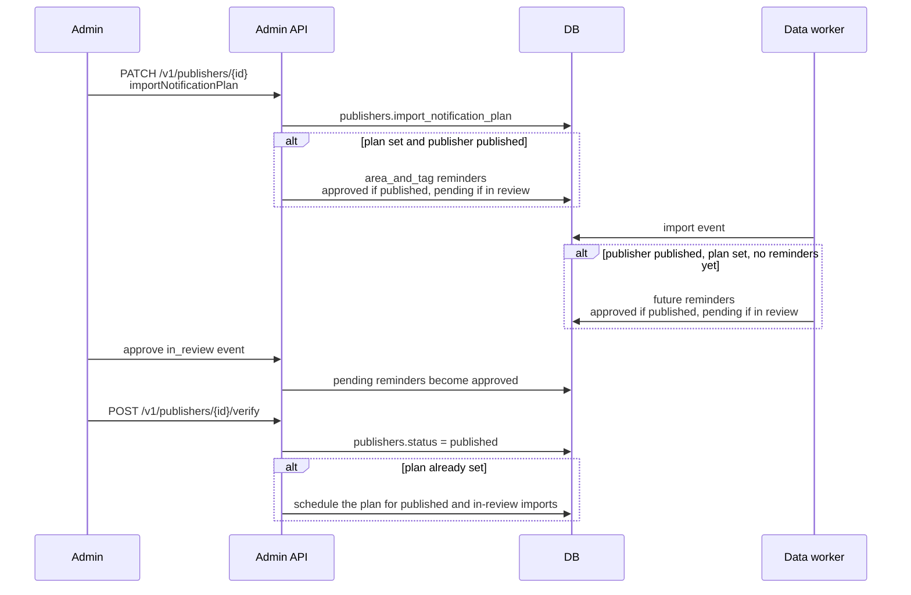

# Publisher import notifications

Admin chooses how a script-imported event is notified. Nothing sends no import notification.
A marketing plan is scheduled only when the publisher status is `published`.

Reminders whose send time is already past are left out. A second import, or saving the plan
again, does not add another set once that event has a non-cancelled `area_and_tag` message.
`pending` reminders are not sent. Publishing the event approves them, and the worker sends
only when the message is `approved` and the event is `published`.
