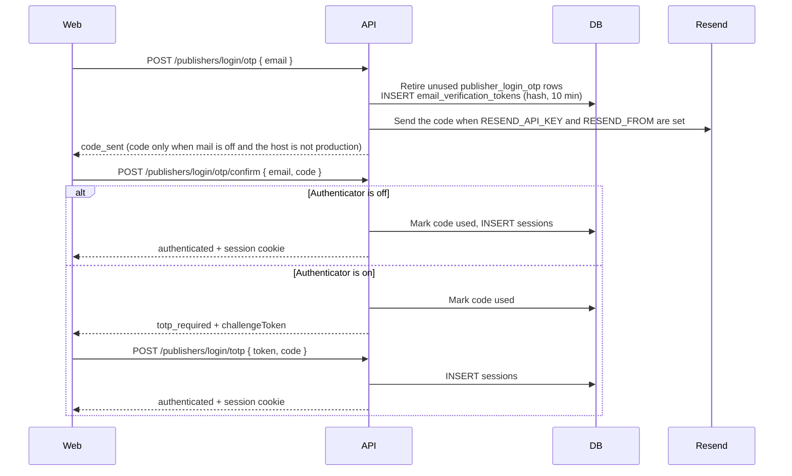

# Publisher email code and authenticator

A publisher signs in with a verified email and password, or with a single-use email code. Either
path sets the httpOnly session cookie immediately when the account has not turned on an
authenticator. When it has, both paths return a challenge and the cookie is set only after the
authenticator code.

The email code lasts 10 minutes, allows five wrong guesses, and an email can request five codes
per 15 minutes. It is stored hashed (`purpose=publisher_login_otp`). An unknown or unverified
email gets the same `code_sent` body and no code. When `RESEND_API_KEY` and `RESEND_FROM` are both
set, the API sends the code with Resend and leaves it out of the response. The from address must
use a domain verified in Resend. Outside production, with Resend unset, the response includes the
code. `PUBLISHER_INCLUDE_LOGIN_OTP=true` includes it in
production too. Leave that unset on a public host. Without `PUBLISHER_OTP_PEPPER` the pepper is
random for the process.

Enrollment stores a pending secret. Login ignores it until the account confirms a code together
with the current password. Turning it off needs the same pair. Starting enrollment again is
refused while an authenticator is already on. A wrong authenticator code during sign-in can be
tried again until that challenge expires. On a publisher, an admin can change only the role, or
unlink the account. The account stays. `GET /publisher-accounts` lists every account and whether
an authenticator is on. `PATCH /publisher-accounts/{accountId}` sets a new password and signs that
account out.
Adding an account looks the email up (`GET /publishers/{id}/accounts/lookup`). A new account needs
a password. An existing account is linked and keeps its password.

