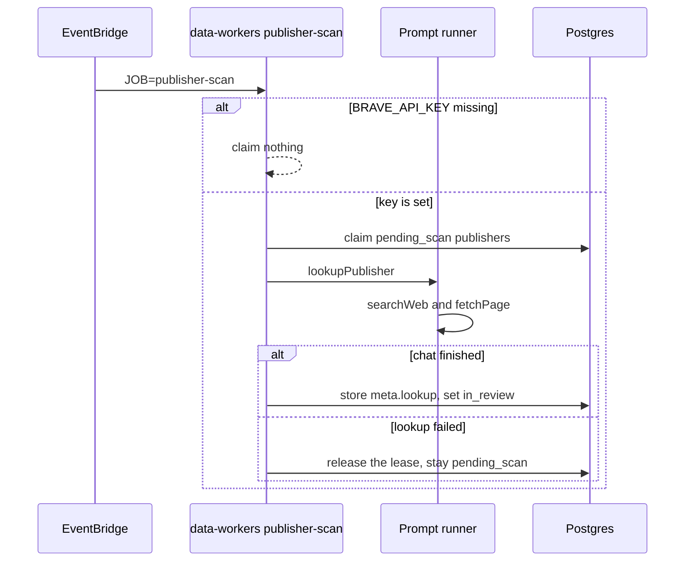

# Publisher scan

A temporary publisher created by the event scan starts as `pending_scan`. The event scan does not
look it up. EventBridge runs the same data-workers task every 5 minutes with `JOB=publisher-scan`.

```bash
pnpm --filter @local-events/data-workers dev -- --job publisher-scan
pnpm --filter @local-events/data-workers dev -- --job publisher-scan --publisher <publisher-id>
pnpm --filter @local-events/data-workers dev -- --job publisher-scan --limit 1
```

The job claims `pending_scan` publishers whose lease is free. It uses one linked event (title,
description, venue, location, source URL) plus the publisher name and organizer keys. With no
`BRAVE_API_KEY` it claims nothing.

A finished chat stores the profile on `publishers.meta.lookup` and sets `in_review`, including when
the chat found no facts. A website from a fetched page is also stored as an organizer key. A model
or network failure releases the lease and leaves the publisher `pending_scan`.

An admin verify sets `published`. That is the accepted state: native events can leave
`awaiting_verification`, and import reminders can be scheduled. `pending_scan` publishers are not
in the review queue.

Native registration creates the publisher as `in_review`. That row is not a lookup.


