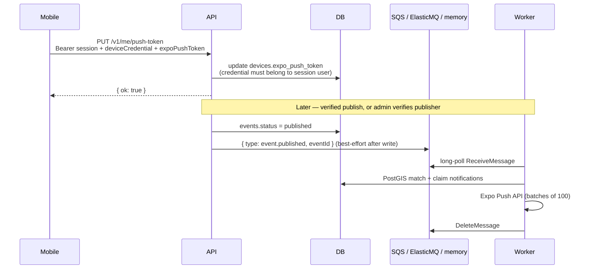

# Push token registration + domain events

Mobile registers an Expo push token on the device row. Publishing a verified event enqueues
`event.published` for the worker (SQS in AWS; ElasticMQ locally via `DOMAIN_EVENTS_QUEUE_URL`;
in-process memory when the queue URL is unset). The worker matches nearby users (areas ∩
interests), applies quiet hours and a daily cap, then sends Expo push and records a
`notifications` row.

## Auth notes

- Session alone is not enough: the body includes `deviceCredential` so the token lands on the
  correct device row (a user can have multiple devices).
- Unverified publishers publish as `awaiting_verification`; `shouldEnqueueNotifications` skips
  those. Admin `POST /v1/publishers/{id}/verify` releases upcoming events and enqueues each one
  that becomes `published`.
- Enqueue is best-effort after the DB write so a transient SQS failure does not roll back publish
  (outbox comes later).
