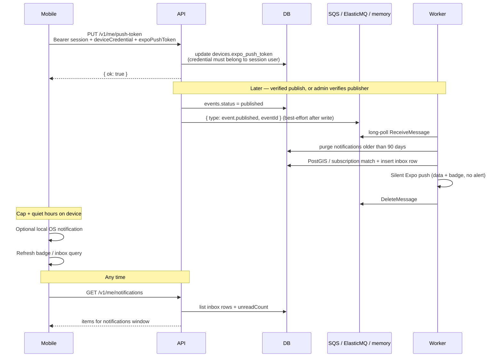

# Push token registration + domain events

Mobile registers an Expo push token on the device row. Publishing a verified event enqueues
`event.published` for the worker (SQS in AWS; ElasticMQ locally via `DOMAIN_EVENTS_QUEUE_URL`;
in-process memory when the queue URL is unset). The worker matches users (areas ∩ interests and
publisher followers), **always** writes a `notifications` inbox row, then always sends a
**silent/data Expo push** (no alert title/body). The app decides whether to present a local OS
notification using quiet hours and the daily cap. The in-app list is API-backed.

## Quiet hours and daily cap (client-only)

- Defaults: enabled, 22:00–08:00 in the user’s timezone (`Europe/Stockholm` at launch). Editable in
  preferences (`PUT /me/quiet-hours`).
- Backend always stores the inbox row and always attempts a silent Expo push (when a token exists).
- Mobile: after a silent push, post a **local** OS notification only if outside quiet hours, under
  the 5/day presentation cap, and the app is not in the foreground. Otherwise update badge/inbox only.
- Opening the app always shows stored inbox rows via `GET /me/notifications` (independent of push
  delivery). Silent pushes are best-effort (iOS throttles background delivery).

## Retention

- Worker hard-deletes inbox rows with `sent_at` older than **90 days** (batched) when handling
  `event.published`.

## Auth notes

- Session alone is not enough: the body includes `deviceCredential` so the token lands on the
  correct device row (a user can have multiple devices).
- Unverified publishers publish as `awaiting_verification`; `shouldEnqueueNotifications` skips
  those. Admin `POST /v1/publishers/{id}/verify` releases upcoming events and enqueues each one
  that becomes `published`.
- Enqueue is best-effort after the DB write so a transient SQS failure does not roll back publish
  (outbox comes later).
