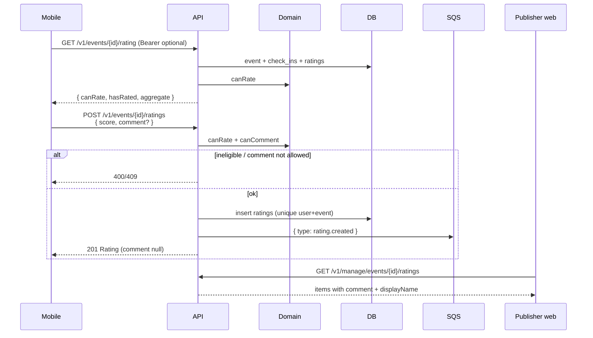

# Ratings (“How was it?”)

Checked-in attendees may rate once from `ends_at` until 14 days after. Public surfaces see
aggregate average + count only. Comments require a named public profile and are returned only on
publisher manage.

