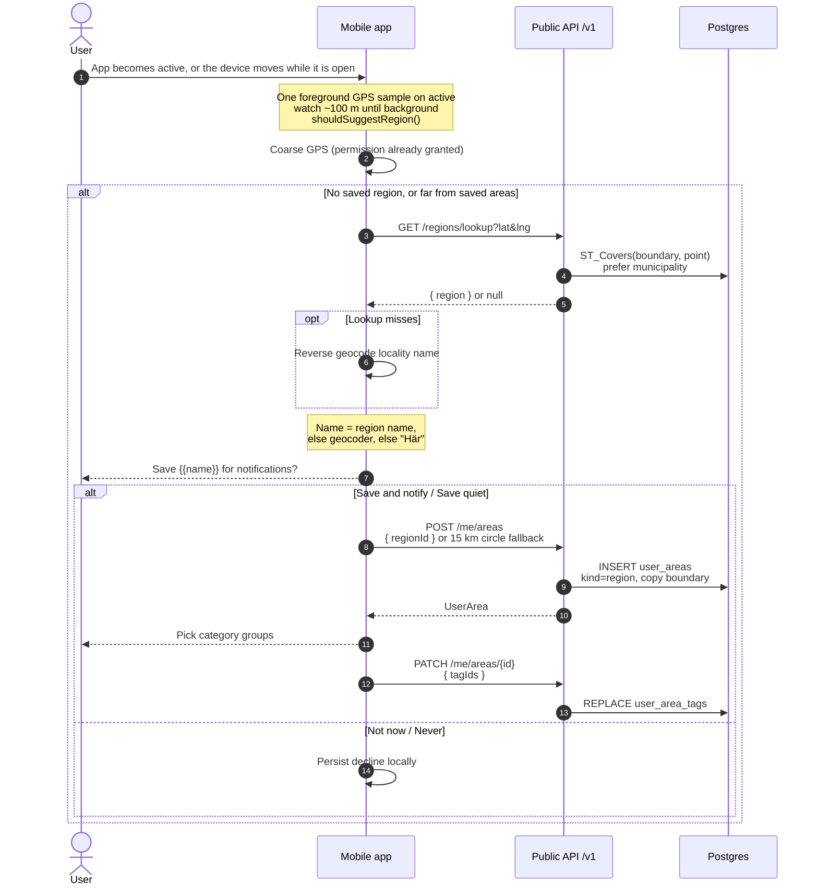

# Region suggestions

When the app opens with no saved region, or is used somewhere new, the device may offer to save
that place as a region subscription. Location stays on-device until the user accepts. Declines
are stored only on the device.

## Sequence

## Notes

- Seed fixtures: Söderhamn kommun `2180` + Gävleborg län `21` (simplified multipolygons).
- Official SCB/Lantmäteriet boundaries can replace fixtures later without API changes.
- The device reads one foreground location when the app becomes active, then watches updates of
  about 100 m while it stays open. The watch stops on background. No background location.
- A region prompt is evaluated on that foreground sample, and again after roughly 1 km of movement
  while the app stays open. No saved region: the prompt is shown on open. Not now, closing the
  sheet, or skipping the onboarding area step hides it for 7 days near that place
  (`firstRegionDismissDays`). Farther than the profile
  setting “How far can you go” (default 25 km), including the same day, the prompt can show again.
- Already has areas: still requires an active session and distance from saved areas. A nearby decline lasts 90 days.
- The suggested name is the covering region from lookup. If lookup misses, the device geocoder supplies a locality, then a generic “Här” / “Here”.
- Fallback geometry when lookup misses: circle with `REGION_SUGGESTION.fallbackRadiusM` (15 km).
- Home and search list “Nära dig” plus each active saved area by that stored name. Choosing an area searches around it with that area’s saved search radius and shows that area’s tags; “Nära dig” uses the device location, its own saved search radius, and the device home filters.
- After a place is saved, the app asks for the same category groups as onboarding and stores them on the area. Skipping stores none, so that place shows every event until tags are chosen.
