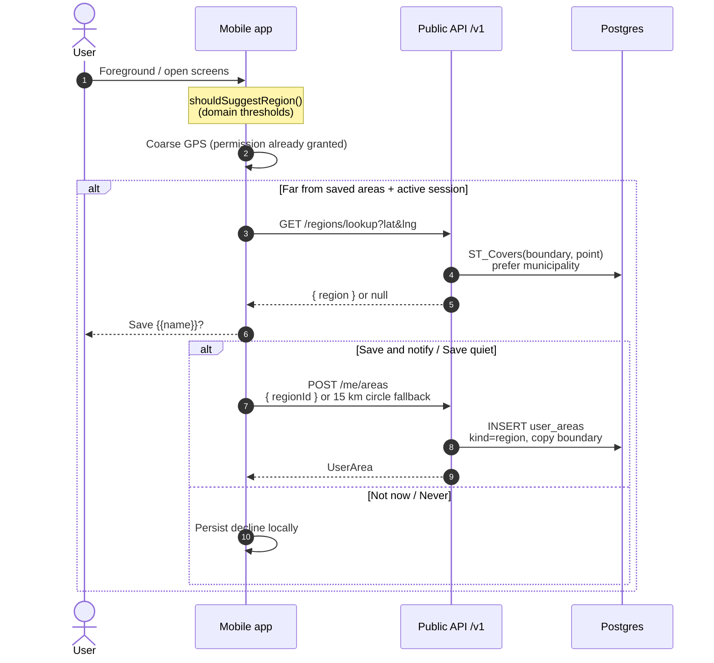

# Region suggestions

When the app is used somewhere new, the device may offer to save that place as a region
subscription. Location stays on-device until the user accepts. Declines are stored only on the
device.

## Sequence

## Notes

- Seed fixtures: Söderhamn kommun `2180` + Gävleborg län `21` (simplified multipolygons).
- Official SCB/Lantmäteriet boundaries can replace fixtures later without API changes.
- Fallback when lookup misses: circle with `REGION_SUGGESTION.fallbackRadiusM` (15 km).
